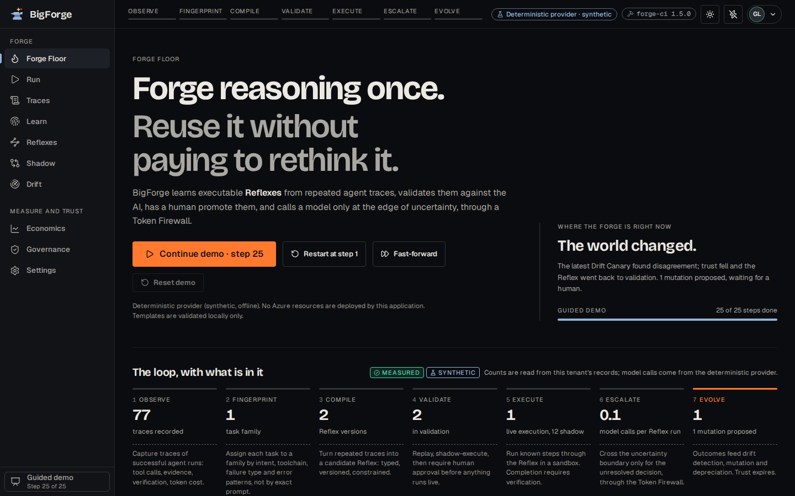
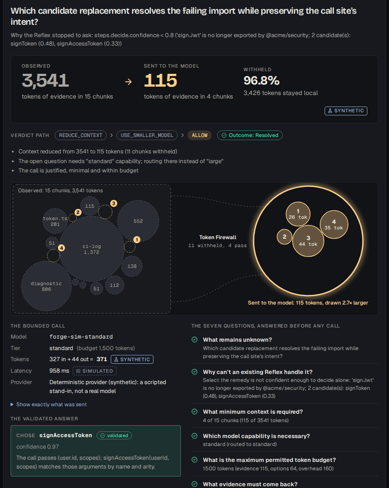
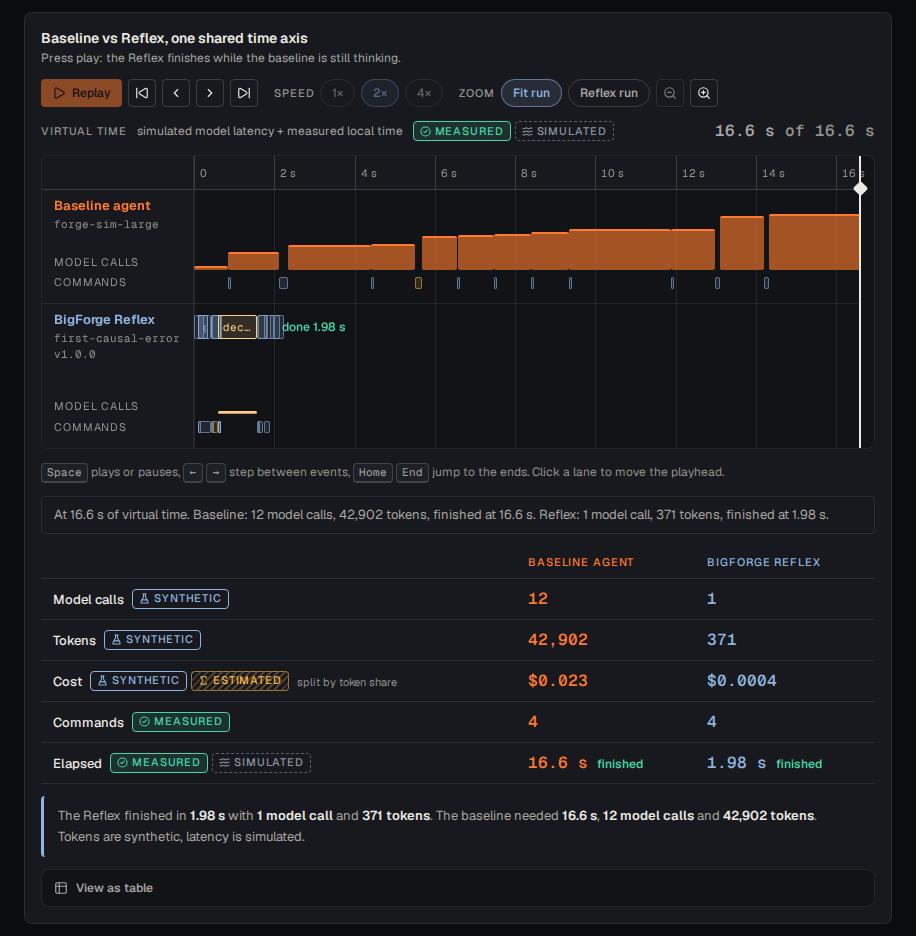
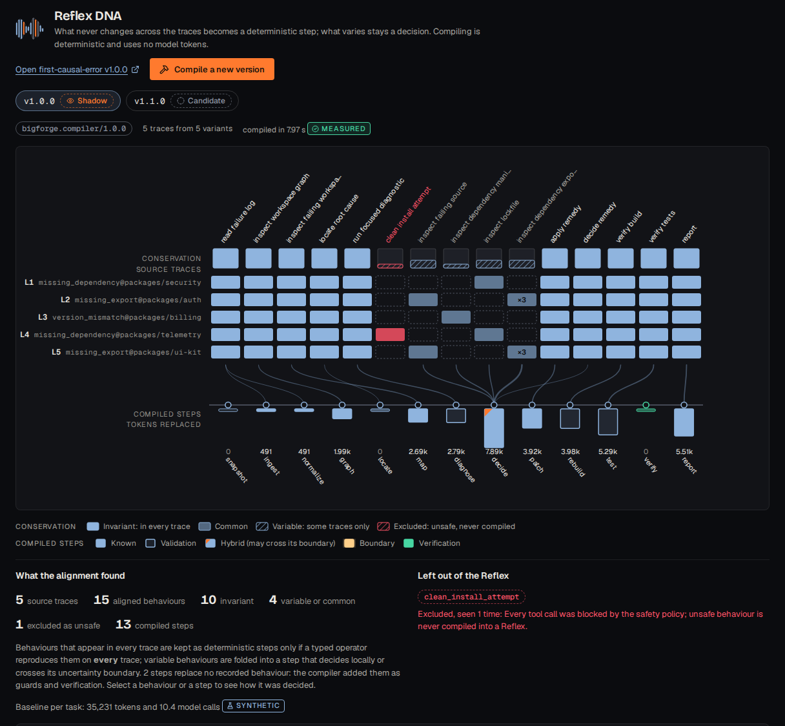
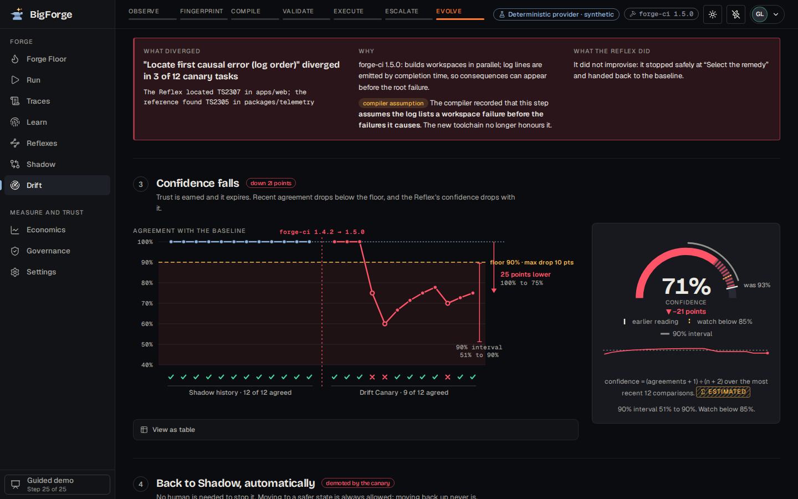
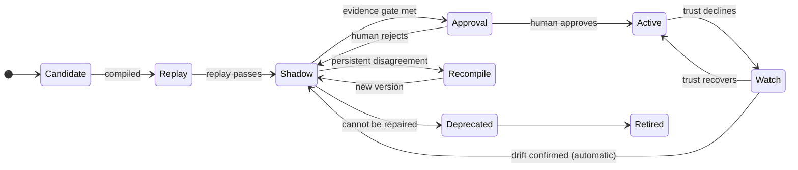
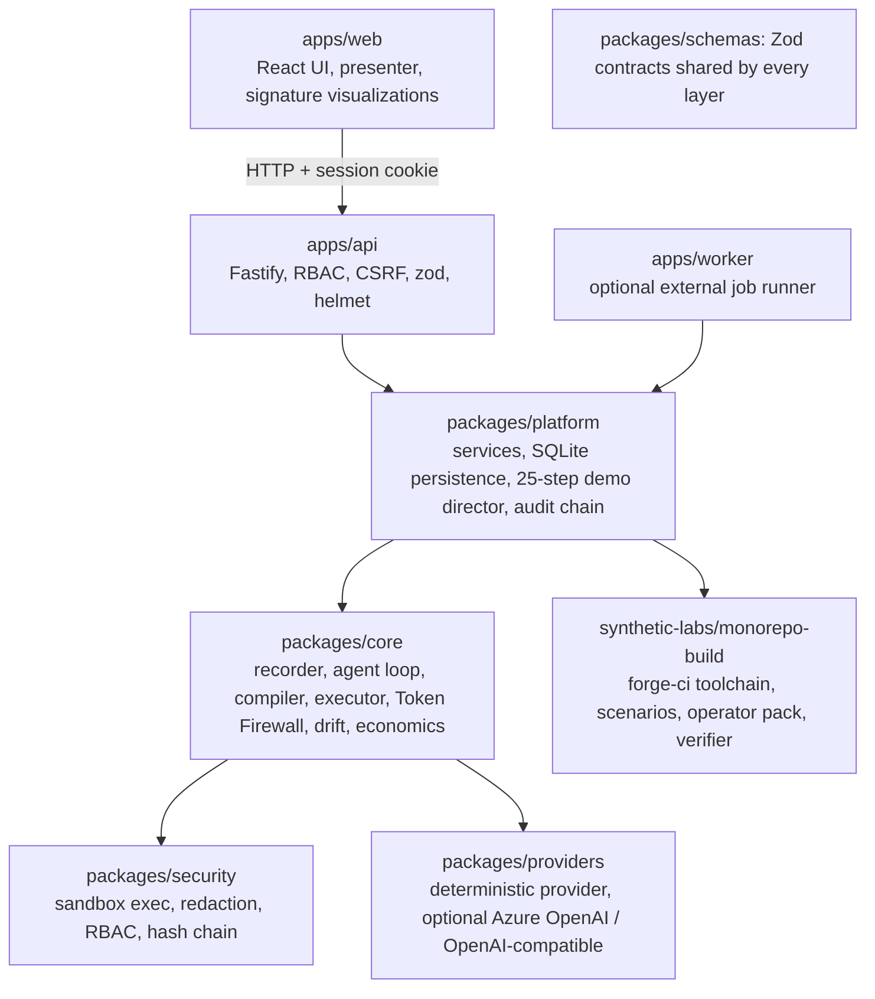

<div align="center">



# BigForge

**Forge reasoning once. Reuse it without paying to rethink it.**

BigForge turns repeated AI reasoning into verified executable **Reflexes**,<br>so models are called only at the edge of uncertainty.

[Try it](#try-it) · [The guided demo](#the-guided-demo) · [How it works](#how-it-works) · [What the numbers mean](#what-the-numbers-mean) · [Security](#security-and-responsible-ai) · [Azure](#azure) · [Limitations](#limitations)

</div>

> [!IMPORTANT]
> **Status: working proof of concept** for the *Hack for Tokenomics: The Zero-Waste AI Challenge*. The whole product runs **offline** on a **synthetic monorepo lab** with a **deterministic provider**: a scripted stand-in for a model, always labelled as such. Every figure is tagged `synthetic`, `simulated`, `estimated`, `replay-measured` or `measured`. Nothing here is benchmarked against real models, and **nothing is deployed to Azure**. Read [Limitations](#limitations) before drawing conclusions.

## BigForge in 30 seconds

AI agents re-solve problems they have already solved: read the logs, find the failing package, choose a diagnostic, verify the fix. Every run pays the full reasoning price again.

BigForge watches _successful, verified_ runs, finds the steps that never change, and compiles them into a **Reflex**: a versioned, testable, permission-constrained workflow. When a task from the same family returns, the known steps run locally with **no model call**. A model is consulted only for the one decision that is genuinely unresolved, and only with the evidence that decision needs. If anything is off, the Reflex stops and the ordinary agent takes over. If the world changes, trust falls and the Reflex returns to shadow mode on its own.

```mermaid
flowchart LR
    subgraph TRAD["Traditional agent: think every time"]
        direction LR
        T1([Task]) --> T2[Model] --> T3[Tools] --> T4[Model] --> T5[Tools] --> T6[Model] --> T7([Result])
    end
    subgraph BF["BigForge: reuse what is known"]
        direction LR
        B1([Task]) --> B2[Reflex match] --> B3[Known steps, no model] --> B4{{Uncertainty boundary}} --> B5[One bounded model call] --> B6[Independent verification] --> B7([Result])
    end
    TRAD ~~~ BF
    classDef spend fill:#bc4c00,stroke:#953800,color:#ffffff;
    classDef known fill:#1f6feb,stroke:#0b4cb3,color:#ffffff;
    classDef edge fill:#bf8700,stroke:#7d5a00,color:#ffffff;
    classDef check fill:#1a7f37,stroke:#116329,color:#ffffff;
    class T2,T4,T6,B5 spend;
    class B2,B3 known;
    class B4 edge;
    class B6 check;
```



> **Think every time** → **reuse what is known; think only at the edge of uncertainty.**

## Try it

Requirements: **Node.js 24+** (BigForge uses the built-in `node:sqlite`) and npm 11. No network access, accounts or API keys are needed after `npm install`.

```bash
git clone https://github.com/snowjug/BigForge.git
cd BigForge
npm install
npm run demo        # builds the web app and server if needed, then serves http://127.0.0.1:4747
```

Open <http://127.0.0.1:4747>, sign in as **Grace** (reviewer) and choose **Start guided demo** on the Forge Floor. The demo identities are public by design and exist only in demo mode:

| Persona               | Role     | Can do                                                    |
| --------------------- | -------- | --------------------------------------------------------- |
| `grace@acme.test`     | reviewer | everything below, and **promote** a Reflex (the human step) |
| `ada@acme.test`       | admin    | settings, demo reset                                      |
| `linus@acme.test`     | operator | run tasks, replay, shadow, canary (cannot promote)        |
| `vera@acme.test`      | viewer   | read-only                                                 |
| `gus@globex.test`     | admin    | a different tenant: cannot see Acme's data                |

Password for all of them: `forge-demo`.

| Command                | What it does                                                                                   |
| ---------------------- | ---------------------------------------------------------------------------------------------- |
| `npm run demo`         | production build + server on `127.0.0.1:4747` (`PORT`, `BIGFORGE_DATA_DIR` are respected)      |
| `npm run dev`          | API (watch mode) + Vite dev server with hot reload on `127.0.0.1:5173`                         |
| `npm run demo:verify`  | headless check of all 25 demo steps through the real HTTP API; exits non-zero on any failure   |
| `npm test`             | unit and integration tests (Vitest)                                                            |
| `npm run test:e2e`     | Playwright end-to-end and accessibility tests against the production bundle (`npm run build` first; `npx playwright install chromium` once) |
| `npm run validate`     | format check, lint, strict typecheck, tests and build                                          |

Or with Docker: `docker build -t bigforge . && docker run --rm -p 4747:4747 bigforge`.

Reaching the server through a port forward, reverse proxy or another machine? `npm run demo` binds to loopback and accepts only loopback `Host` headers (a DNS-rebinding defence). List other names in `BIGFORGE_ALLOWED_HOSTS` (comma separated), or deliberately expose the demo on all interfaces with `HOST=0.0.0.0 BIGFORGE_MODE=demo npm run demo`, which is what the container does. The demo is plain HTTP and its identities are public, so keep it off untrusted networks.

## The guided demo

One story, 25 steps, in five scenes, driven by a presenter bar (`Back`, `Next`, `Restart`, `Exit`, arrow keys). Every step runs real code against a synthetic repository; the bar only navigates and triggers actions.

| Scene              | Steps | What happens                                                                                                                                                 |
| ------------------ | ----- | ------------------------------------------------------------------------------------------------------------------------------------------------------------ |
| **Cold start**     | 1–3   | A monorepo build failure arrives. No Reflex exists, so the baseline agent solves it, calling the model on every turn. The execution trace is captured.        |
| **Learning**       | 4–7   | Four related failures follow. BigForge groups them into a task family, aligns the traces, separates invariant from variable steps and compiles a candidate Reflex. |
| **Validation**     | 8–11  | Historical traces are replayed against the candidate; it runs in Shadow Brain mode beside the baseline; the comparison is shown; **a human reviewer promotes it**. |
| **The killer moment** | 12–20 | A new, deliberately ambiguous task arrives. The Reflex is selected, known steps run with **zero** model calls, one Uncertainty Boundary is reached, the Token Firewall selects the minimum evidence, one bounded call resolves it, execution continues and an independent verifier confirms the result. Baseline and BigForge are compared. |
| **Drift**          | 21–25 | A synthetic toolchain upgrade changes log ordering. The Drift Canary detects disagreement, confidence falls, the Reflex returns to Shadow automatically and a mutation is **proposed, not activated**. |

<table>
<tr>
<td width="50%"><br><sub><b>Uncertainty Lens.</b> Everything observed (faded) versus the few chunks the Token Firewall sent to the model.</sub></td>
<td width="50%"><br><sub><b>Baseline vs Reflex.</b> Two lanes on one virtual time axis: model calls sized by tokens against local steps.</sub></td>
</tr>
<tr>
<td><br><sub><b>Reflex DNA.</b> Source traces aligned by behaviour; solid columns are invariant, hatched columns vary.</sub></td>
<td><br><sub><b>Drift fracture.</b> The step that diverged, the canary grid and a mutation that is proposed but not activated.</sub></td>
</tr>
</table>

If you are presenting, see the [demo guide](docs/DEMO_GUIDE.md) (five-minute script, two-minute fallback, thirty-second pitch) and the [judge Q&A](docs/JUDGE_QA.md).

## How it works

One loop: **observe → fingerprint → compile → validate → execute → escalate → evolve.**

1. **Observe.** Capture vendor-neutral traces ([`bigforge.trace/v1`](docs/FORMATS.md)): tool calls, evidence, verification, token usage. Secrets are redacted at capture.
2. **Fingerprint.** Assign each task to a family by intent, toolchain, failure type, error classes and affected workspaces, not by exact prompt. A false match is the most dangerous failure, so hard gates (evidence present, same intent, toolchain and failure type, only known error classes) must pass before a similarity score is even considered, and the _false-match rate_ is a measured, labelled metric.
3. **Compile.** Align several verified traces, separate invariant from variable behaviour, and bind each model decision to a deterministic **operator** from a typed library _only if that operator reproduces the recorded decision on every trace_. Decisions with no consistent operator stay as Uncertainty Boundaries. The compiler records the assumptions it had to make so a reviewer can read them. It composes operators; it does not synthesise arbitrary code.
4. **Validate.** Replay history, run **Shadow Brain** beside the baseline, then require a human reviewer. Promotion is gated on replay agreement, shadow volume and variety, zero safety violations and a minimum agreement, and the server re-checks the evidence and the content hash.
5. **Execute.** Known steps run in the sandbox under the Reflex's _own_ declared permissions. Anything unexpected (failed precondition, denied action, unexpected output, failed verification) stops the Reflex; it never improvises.
6. **Escalate.** At an **Uncertainty Boundary** the **Token Firewall** answers seven questions before any call may exist (what is unknown, why not a Reflex, minimum context, capability, budget, evidence required, how it will be verified), selects the minimum evidence, screens it for injected instructions, picks the smallest adequate model tier and caps calls at three per run. The answer must parse and be one of the offered options.
7. **Evolve.** A **Drift Canary** keeps comparing the Reflex with the baseline. When agreement falls, confidence drops and the Reflex demotes itself to Shadow. A **mutation** may be proposed with a regression replay, but never activated without a reviewer.



**Verification-first completion.** A task is not done because a model said so or a command exited 0. An independent verifier checks that the original failure is gone, the relevant tests pass, no unrelated files changed and the security policy holds, for the baseline agent and the Reflex alike.

**Why this is different from compression, memory, caching and routing.** Those make a model call cheaper or better informed. BigForge asks whether the call needs to exist. They compose: the Token Firewall compresses and routes the residual call, caching still applies to it, and memory can supply evidence. A fuller comparison and the original reasoning are in [docs/VISION.md](docs/VISION.md).

### Architecture



A modular monolith: one deployable (API + static web app + in-process job runner) with an optional external worker. Details in [docs/ARCHITECTURE.md](docs/ARCHITECTURE.md); the Reflex and trace formats are in [docs/FORMATS.md](docs/FORMATS.md).

## What the numbers mean

BigForge's central claim is about **model consumption**, so the accounting is explicit.

| Label             | Meaning                                                                 | Example                                                |
| ----------------- | ----------------------------------------------------------------------- | ------------------------------------------------------ |
| `measured`        | observed from a real system                                             | local command duration; live-provider usage            |
| `synthetic`       | produced by the deterministic provider (a scripted stand-in for a model) | token counts, cached tokens, cost derived from them    |
| `simulated`       | computed from a documented deterministic model                           | model latency of the deterministic provider            |
| `estimated`       | counterfactual or projected                                              | ROI projections, tokens avoided with no reference run |
| `replay-measured` | measured by re-running a recorded task against a Reflex                  | replay agreement, CRR of replayed runs                 |

Estimated and observed values are never merged into one unlabelled figure; pricing is an assumption with a timestamp. In the demo, the baseline agent makes roughly 9–12 model calls per task; a known task through the promoted Reflex makes **none**; the held-out ambiguous task makes **one**, carrying about a hundred tokens of evidence selected from about 3,500 observed (all `synthetic`).

Token savings and dollar savings are **not the same thing here**. The simulated baseline benefits from prompt caching (about 96% of its input tokens are cache hits) and the economics include an _assumed_ human-review cost, so **dollar ROI can be negative at demo volumes while token ROI is strongly positive**, and what the demo actually executed (realised) is lower than the projection. The Economics page shows both, with the formulas, instead of choosing the flattering one. The **Cognitive Reuse Ratio** is a proposed BigForge metric, not an industry standard. Formulas, sources and limits: [docs/METRICS.md](docs/METRICS.md).

## Testing and validation

```bash
npm run validate   # prettier, eslint (typed), strict TypeScript, Vitest, production build
npm run demo:verify
npm run test:e2e
npm run scan:secrets && npm run audit:deps
```

Risk-based coverage: command safety and sandbox containment, redaction, RBAC and tenant isolation, the Reflex lifecycle and promotion gate, uncertainty boundaries and the Token Firewall, model-output validation, verification (including a plausible-but-wrong repair that compiles yet is caught), drift, database migrations from a clean state, the full 25-step demo over HTTP, and Playwright end-to-end and axe accessibility checks. Results with exact commands and dates are recorded in the [validation ledger](docs/VALIDATION_LEDGER.md), including failures and fixes.

## Security and responsible AI

- **Application-level containment, not OS-grade sandboxing.** Commands are structured (never a shell), allowlisted and path-confined, with scrubbed environments, timeouts and output caps. There is no network namespace, seccomp or cgroup enforcement. [docs/SECURITY.md](docs/SECURITY.md) separates application-level containment, container isolation and production-grade sandboxing.
- **Human approval gates promotion.** Generated Reflexes are never auto-promoted; drift demotion is automatic and mutations are only proposed. Every decision is attributed and recorded in an append-only, hash-chained audit log.
- **Defence in depth**: RBAC in the service layer, tenant-scoped data access, CSRF header and `Sec-Fetch-Site` checks, strict CSP, secret redaction at capture, injection screening of evidence, model-output validation with safe fallback, fail-closed production mode.
- **Independently reviewed.** A separate read-only security review confirmed seven issues; all were fixed with regression tests ([details](docs/SECURITY.md#independent-security-review-2026-11-06)). It is not a substitute for a human penetration test.
- **Responsible AI**: humans stay in the loop, automation is legible (every step records why it exists and what it replaced), assumptions are surfaced before approval, learning uses observable behaviour only, and the demo data is synthetic.

## Azure

Azure is optional; the product is complete without it. The repository contains Bicep templates (Container Apps, Container Registry, Key Vault, user-assigned managed identity, Log Analytics and Application Insights, optional Azure OpenAI and budget), a manual OIDC deployment workflow, a CI workflow, a container image and an Azure OpenAI provider adapter.

| Item                                             | Status                                                                                  |
| ------------------------------------------------ | --------------------------------------------------------------------------------------- |
| Bicep build, lint and parameter compilation      | **Validated locally**                                                                   |
| Container image build, health check, non-root run | **Validated locally**                                                                   |
| `az deployment what-if`, ARM validation, deployment | **Not run.** No Azure resource has been created                                      |
| Azure OpenAI live model call, Application Insights telemetry | **Not performed.** The adapter is validated against a local protocol stub only |

See [docs/AZURE.md](docs/AZURE.md) for the architecture, managed-identity and Key Vault design, cost controls, what-if usage and the honest status table.

## Limitations

- **Synthetic, one family.** The lab covers monorepo build failures (three fault kinds). Results demonstrate the mechanism, not general savings; there are no benchmark claims.
- **The model is scripted.** Agreement between the deterministic agent and the operators is partly by construction, and the drift magnitude is tuned for the lab. Live mode swaps only the provider and is validated against a protocol stub only.
- **The compiler selects and parameterises operators** from a typed library; it does not synthesise code. Fingerprinting is rule-based, not embeddings.
- **Single node.** SQLite on one node; no OS-grade sandbox; sessions cannot be revoked before they expire.
- **Not deployed.** Azure assets are validated locally only.

The complete, current list is in [docs/KNOWN_LIMITATIONS.md](docs/KNOWN_LIMITATIONS.md).

## Roadmap

| Next                                                                 | Why                                                                          |
| -------------------------------------------------------------------- | ---------------------------------------------------------------------------- |
| Record real agent traces behind the trace format; shadow on held-out real tasks | The only way to learn whether the savings survive real models           |
| More task families (flaky tests, dependency bumps, lint) and held-out evaluation | Tests generalisation and the false-match rate                           |
| Production-grade sandboxing (gVisor / Firecracker / nsjail)          | Replace application-level containment for untrusted repositories             |
| PostgreSQL adapter and a distributed Reflex registry                 | Multi-node operation                                                         |
| Live-provider validation and an Azure what-if / deployment with smoke tests | Turn "validated locally" into "validated in Azure"                        |

## Repository layout

| Path                              | Contents                                                                      |
| --------------------------------- | ----------------------------------------------------------------------------- |
| `apps/web`                        | React 19 UI: shell, presenter, signature visualizations (Forge Graph, Uncertainty Lens, Reflex DNA, economics, drift) |
| `apps/api`, `apps/worker`         | Fastify API; optional external job worker                                     |
| `packages/schemas`                | Zod contracts: trace, Reflex, fingerprint, firewall, economics, API DTOs      |
| `packages/core`                   | compiler, executor, Token Firewall, drift, economics, sandbox, agent loop     |
| `packages/platform`               | services, SQLite persistence, demo director, audit                            |
| `packages/security`, `providers`, `observability` | sandboxed execution, redaction, RBAC; providers; metrics and tracing |
| `synthetic-labs/monorepo-build`   | the synthetic lab: `forge-ci` toolchain, scenarios, operator pack, verifier   |
| `infra`, `.github`, `Dockerfile`  | Bicep, CI/CD workflows, container image                                       |
| `docs`                            | architecture, formats, metrics, security, Azure, demo guide, decisions, ledger, limitations, original vision |

## Documentation

[Demo guide](docs/DEMO_GUIDE.md) · [Judge Q&A](docs/JUDGE_QA.md) · [Architecture](docs/ARCHITECTURE.md) · [Formats](docs/FORMATS.md) · [Metrics](docs/METRICS.md) · [Security](docs/SECURITY.md) · [Azure](docs/AZURE.md) · [Design system](docs/DESIGN_SYSTEM.md) · [Decisions](docs/DECISIONS.md) · [Validation ledger](docs/VALIDATION_LEDGER.md) · [Known limitations](docs/KNOWN_LIMITATIONS.md) · [Original vision](docs/VISION.md)

## License

No license has been selected yet, so all rights are reserved by default. The repository owner needs to choose one before external contributions are accepted or reuse is encouraged. Third-party projects mentioned in the documentation belong to their authors and imply no affiliation or endorsement.

## Project philosophy

Reasoning is an expensive resource, best spent where it creates new information. Reuse what is known; think only at the edge of uncertainty. Trust is earned with evidence and allowed to expire. Savings never outrank safety or correctness. Claims follow measurements, never the other way around.

**Forge reasoning once.**
