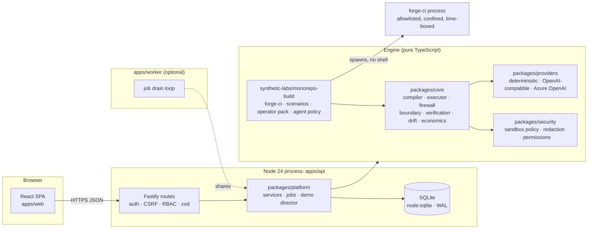
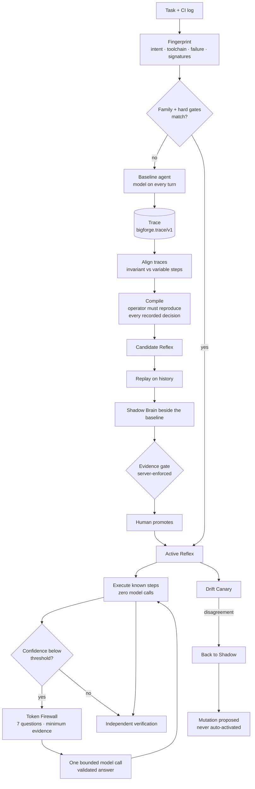

# Architecture

BigForge is a **modular monolith with one optional worker**. One Node 24 process serves the API and the web app; the same application layer can also run in a separate worker process. There is no message broker and no microservice mesh: the scale of the problem does not justify one.

## Packages

| Package | Responsibility | Depends on |
|---|---|---|
| `@bigforge/schemas` | Zod/TypeScript contracts: trace, Reflex, fingerprint, firewall, economics, API DTOs, metric definitions | zod |
| `@bigforge/security` | Redaction, path confinement, structured command policy, sandboxed exec, permission guard, RBAC, hash chain, session auth, instruction screening | schemas |
| `@bigforge/providers` | `Provider` interface, deterministic provider (synthetic tokens, simulated latency/cache), OpenAI-compatible and Azure OpenAI adapter | security |
| `@bigforge/core` | The engine: sandbox, trace recorder, baseline agent loop, operator framework, **Reflex Compiler**, **Reflex executor**, **Token Firewall**, uncertainty-boundary resolution, fingerprinting/clustering, comparison, lifecycle, trust/drift, economics | schemas, security, providers |
| `@bigforge/lab-monorepo` | The synthetic lab: `forge-ci` toolchain, scenario generator, operator pack, scripted agent policy, independent verifier | core |
| `@bigforge/platform` | Persistence (versioned migrations, tenant-scoped repositories), services, job runner, the 25-step demo director | all engine packages |
| `@bigforge/observability` | Metrics registry, OpenTelemetry span helper, optional exporters | none |
| `apps/api` | HTTP boundary | platform |
| `apps/worker` | External job worker | platform |
| `apps/web` | SPA | schemas (types only) |

Dependencies point inward: the web app never imports server code; the engine never imports the platform; the platform is the only layer that touches the database.

## Why these choices (see also [DECISIONS.md](./DECISIONS.md))

- **SQLite via `node:sqlite`**: offline, zero native build, one file. Repositories centralise `tenant_id` filtering so a PostgreSQL adapter is possible later. Single-node by design.
- **Packages consumed as TypeScript source** with `erasableSyntaxOnly`; the production server is one esbuild bundle (`dist/server/main.mjs`) with third-party packages external.
- **Deterministic provider** instead of mocks: the agent loop, tool gateway, firewall, verification and compiler run *identical code* in demo and live mode. Only the `Provider` differs.

## The learning loop

## Execution safety model

Every action an agent or a Reflex takes goes through one gateway: **path confinement → permission guard → command policy → sandboxed spawn → redaction → trace**. See [SECURITY.md](./SECURITY.md).

## Persistence

`packages/platform/src/db/migrations.ts` holds numbered, checksummed SQL. Editing an applied migration fails startup. All tenant tables carry `tenant_id` and are accessed only through `TenantStore`. `audit_events` is append-only (triggers) and hash-chained per tenant; `GET /api/audit/verify` recomputes the chain.

## Jobs

Long operations (batch learning, shadow runs, drift canary, mutation proposal) are rows in `jobs`. By default the API drains them in-process (`BIGFORGE_JOBS_MODE=inline`); with `external`, `apps/worker` does. The guided demo awaits jobs server-side and exposes progress through `GET /api/demo`.

## Observability

Structured logs carry request metadata only (cookies and bodies are redacted). `GET /api/metrics` (admin) exposes Prometheus metrics: request counts by *route pattern*, runs by kind and outcome, tokens by provenance, firewall verdicts, lifecycle transitions, jobs. OpenTelemetry spans use `@opentelemetry/api`; exporters (Azure Monitor, OTLP) are optional packages and the app reports honestly when they are absent.
