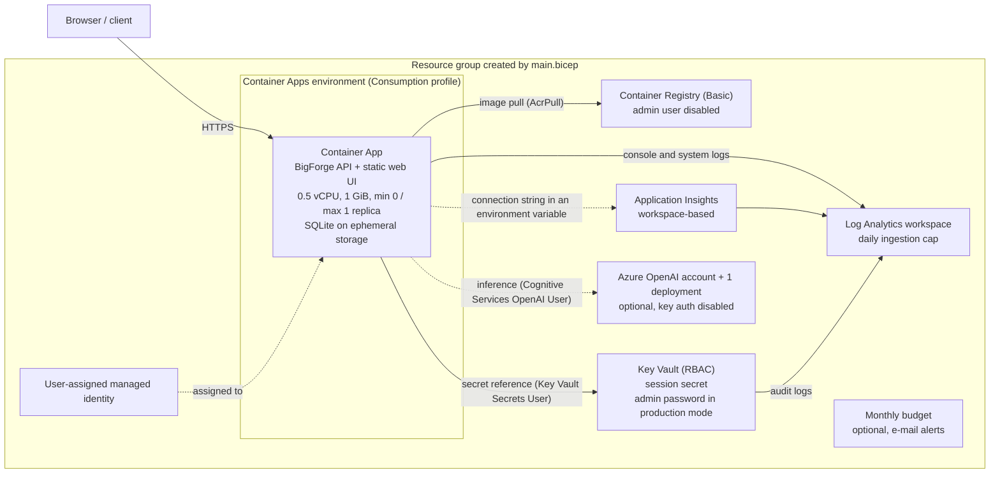

# BigForge on Azure

Azure is **optional**. BigForge runs fully offline in deterministic demo mode (see the [README](../README.md));
nothing in this document is needed for that. This page describes the Azure Container Apps deployment that the
files in `infra/`, `Dockerfile`, `.github/workflows/` and `scripts/azure-*.sh` describe.

> [!IMPORTANT]
> **Templates are validated locally only; nothing is deployed.** No Azure resource has been created, changed or
> deleted by authoring these files, no what-if has been run, and no cost has been measured. Read
> [Honest status](#honest-status) before relying on anything here.

## Contents

1. [Honest status](#honest-status)
2. [Target architecture](#target-architecture)
3. [README services versus what the templates create](#readme-services-versus-what-the-templates-create)
4. [Managed identity design](#managed-identity-design)
5. [Key Vault integration points](#key-vault-integration-points)
6. [Application Insights and OpenTelemetry](#application-insights-and-opentelemetry)
7. [Cost controls and scale limits](#cost-controls-and-scale-limits)
8. [Limitations](#limitations)
9. [Production mode](#production-mode)
10. [Validate locally](#validate-locally)
11. [Preview with what-if (read-only)](#preview-with-what-if-read-only)
12. [Deploy only with explicit authorization](#deploy-only-with-explicit-authorization)
13. [GitHub OIDC setup](#github-oidc-setup)
14. [CI/CD workflows](#cicd-workflows)
15. [Security notes](#security-notes)
16. [Reference: parameters, resource names, app environment](#reference-parameters-resource-names-app-environment)

## Honest status

Update this table, and `docs/VALIDATION_LEDGER.md`, whenever any row changes.

| Item                                           | Status                                                                                                                                                         |
| ---------------------------------------------- | -------------------------------------------------------------------------------------------------------------------------------------------------------------- |
| Bicep templates (`infra/main.bicep`, modules)  | **Authored; built and linted locally** with Bicep CLI 0.48.1 (Azure CLI 2.92.0) on 2026-11-06: no errors, no warnings. Commands are in [Validate locally](#validate-locally). |
| `infra/main.bicepparam`                        | Compiles locally with `az bicep build-params`; override and rejection paths exercised locally (for example an unlisted environment name is a compile error).    |
| `az deployment sub what-if`                    | **Not run.**                                                                                                                                                   |
| ARM validation or any deployment               | **Not performed.** The templates have never been sent to Azure, so deploy-time failures (quota, policy, naming, API behaviour) are possible.                    |
| Smoke test against an Azure deployment         | **Not performed.**                                                                                                                                             |
| Azure OpenAI account, live model call          | **Not performed.** The adapter is validated only against a local protocol stub unless `docs/VALIDATION_LEDGER.md` says otherwise.                                |
| Application Insights telemetry arriving        | **Not observed.** Locally, an image with the Azure Monitor exporter installed logged that it was exporting, using a dummy connection string that pointed at a local port, so no real Application Insights resource was involved. The Statsbeat opt-out variables are set by default; which of them take effect was established by reading the packages' source, **not** by observing network traffic. |
| Production-mode bootstrap admin (`appMode=production`) | **Authored; compiled locally.** `az bicep build-params` accepts `BIGFORGE_AZURE_APP_MODE=production` with dummy admin values, and the Container App module's wiring conditions were evaluated offline with `bicep snapshot` against dummy ids (wired only in production with both values; ignored in demo mode). The scripts' and workflow's admin checks were exercised from extracted copies with dummy values. **Never deployed; a sign-in with the seeded admin has never been tried, and the second Key Vault reference has never been resolved by Container Apps.** |
| Container image                                | Built and run locally from the working tree at authoring time: runs as a non-root user, `/api/health` and `/api/ready` answered, Docker `HEALTHCHECK` became healthy under a 0.5 CPU / 1 GiB limit. Never pushed anywhere. |
| `scripts/azure-whatif.sh`, `azure-deploy.sh`   | Checked with `bash -n` and shellcheck. **Never executed.**                                                                                                     |
| `.github/workflows/*.yml`                      | YAML parsed, `prettier --check` passes, and actionlint (which runs shellcheck on every script block) reports nothing. **Never run on GitHub.**                  |
| Cost                                           | **Not measured.** This document gives no prices; cost guidance is qualitative.                                                                                 |

## Target architecture



What `main.bicep` does, in order: creates the resource group, then deploys the modules in `infra/modules/`. The
**Container App is created only when an image is supplied** (`containerImage`), because the registry is created by the
same template and starts empty. So a deployment has two phases, described in
[Deploy only with explicit authorization](#deploy-only-with-explicit-authorization):

1. **Foundation** (no image): resource group, Log Analytics, Application Insights, managed identity, Key Vault (and the
   session secret and, in production mode, the admin password, when values are supplied), Container Registry, Container
   Apps environment, and optionally Azure OpenAI and the budget.
2. **Application** (image supplied): everything above plus the Container App.

Deployments use the default incremental mode. Running phase 1 again after the app exists does not delete the app, but it
does write a new session-secret version to Key Vault.

## README services versus what the templates create

The README's "Proposed Azure integration" table lists targets, not commitments. This is what the templates actually do:

| README proposal                                       | In the templates?    | What the templates do instead                                                                                                                                                                                  |
| ----------------------------------------------------- | -------------------- | -------------------------------------------------------------------------------------------------------------------------------------------------------------------------------------------------------------- |
| Azure Container Apps (gateway / API)                  | **Yes**              | One Container App on the Consumption workload profile serving the API and the static web UI.                                                                                                                  |
| Azure Functions or Container Apps jobs (workers)      | **No**               | Jobs run in-process in the API container (the app's default `BIGFORGE_JOBS_MODE=inline`). `dist/server/worker.mjs` is in the image but nothing runs it. No Functions app and no Container Apps job exist.        |
| Azure Cosmos DB or PostgreSQL                         | **No**               | SQLite (`node:sqlite`) on the replica's ephemeral storage. A PostgreSQL adapter is **future work and not implemented**; see [Limitations](#limitations).                                                        |
| Azure Blob Storage (traces, replay artifacts)         | **No**               | The database and sandbox workspaces live under the data directory on ephemeral storage.                                                                                                                       |
| Azure OpenAI                                          | **Optional**         | `deployAzureOpenAi` (default `false`) creates one account and one model deployment with API-key authentication disabled. The app calls it only when `providerMode` is `live`.                                  |
| Microsoft Foundry                                     | **No**               | Not created and not referenced.                                                                                                                                                                                |
| Azure Monitor / Application Insights                  | **Yes**              | Log Analytics workspace and a workspace-based Application Insights component. See [Application Insights and OpenTelemetry](#application-insights-and-opentelemetry) for what the app must also have installed.   |
| Azure Key Vault                                       | **Yes**              | One RBAC-authorized vault holding the session secret and, in production mode, the operator's admin password; see [Key Vault integration points](#key-vault-integration-points). |
| Microsoft Entra ID (authentication and RBAC)          | **Partly**           | Entra ID is used for **workload identity only** (the managed identity). There is no end-user sign-in with Entra ID; the app's own roles (admin, reviewer, operator, viewer) are application-level.              |
| Azure Service Bus                                     | **No**               | Not created.                                                                                                                                                                                                   |

Created although the README did not list them: Azure Container Registry (to hold the image), a user-assigned managed
identity, Log Analytics (backing both Container Apps logs and Application Insights), and an optional budget.

## Managed identity design

One **user-assigned** managed identity (`id-<workload>-<environment>`) is shared by the Container App. It is
user-assigned rather than system-assigned so that it, and its role assignments, exist **before** the first revision
needs to pull an image or read a secret.

| Role (built-in)                    | Scope                          | Used for                                                                                   |
| ---------------------------------- | ------------------------------ | ------------------------------------------------------------------------------------------ |
| `AcrPull`                          | The container registry         | Pulling the image (`registries[].identity` on the Container App).                          |
| `Key Vault Secrets User`           | The key vault                  | Resolving the Key Vault secret references on the Container App (`secrets[].identity`): the session secret, and the admin password in production mode. |
| `Cognitive Services OpenAI User`   | The Azure OpenAI account       | Inference calls. **Only created when `deployAzureOpenAi` is `true`.**                      |

- Every assignment is scoped to a single resource, not to the resource group or the subscription, and uses
  `principalType: ServicePrincipal`.
- No API keys are used: the registry admin user is disabled, and the Azure OpenAI account is created with local (key)
  authentication disabled.
- When Azure OpenAI is deployed the app receives `AZURE_OPENAI_AUTH=entra` and `AZURE_CLIENT_ID=<identity client id>`.
  The app's live provider uses `DefaultAzureCredential`, which needs `AZURE_CLIENT_ID` to pick a **user-assigned**
  identity. It loads `@azure/identity` dynamically, and that package is **not** in the default image; see
  [Application Insights and OpenTelemetry](#application-insights-and-opentelemetry) for how to add it.
- The identity that **deploys** the templates (the GitHub OIDC principal, or you) is a different principal; see
  [GitHub OIDC setup](#github-oidc-setup).

## Key Vault integration points

The vault uses Azure RBAC (no access policies), soft delete (7 to 90 days, default 7), and optional purge protection
(`keyVaultPurgeProtection`, default `false`; it cannot be disabled once enabled). Audit logs go to Log Analytics.

| Integration point                                          | How                                                                                                                                                                                            |
| ---------------------------------------------------------- | ---------------------------------------------------------------------------------------------------------------------------------------------------------------------------------------------- |
| `BIGFORGE_SESSION_SECRET`                                  | The Container App declares a secret whose `keyVaultUrl` is `<vault uri>secrets/bigforge-session-secret` (no version, so the latest version) with the managed identity, and an environment variable that references it with `secretRef`. |
| Where the secret value comes from                          | The `sessionSecret` parameter (secure). When it is empty the template writes nothing and the secret must already exist before the Container App is created. The scripts and workflow generate a random value for phase 1 and do not pass one in phase 2. The value is never printed and never committed. |
| Length                                                     | In `production` mode the app refuses to start unless the session secret is at least 32 characters. The generated value (48 random bytes, base64) satisfies that; a value you supply must too.   |
| Rotation                                                   | Each phase-1 run writes a new session-secret version. See the Azure Container Apps documentation for when a changed Key Vault value is picked up.                                              |
| `BIGFORGE_BOOTSTRAP_ADMIN_PASSWORD` (production mode only) | The Container App declares a second secret, `bootstrap-admin-password`, whose `keyVaultUrl` is `<vault uri>secrets/bigforge-bootstrap-admin-password`, with the same managed identity, and an environment variable that references it with `secretRef`. The Key Vault secret, the Container App secret and the variable exist only when `appMode` is `production` **and** both `bootstrapAdminEmail` and `bootstrapAdminPassword` are provided. See [Production mode](#production-mode). |
| Where the admin password comes from                        | The `bootstrapAdminPassword` parameter (secure), **supplied by the operator**: `BIGFORGE_AZURE_ADMIN_PASSWORD` locally, the `azure-production` environment secret `AZURE_ADMIN_PASSWORD` in the workflow. It is **never generated** (a generated password nobody saw would leave nobody able to sign in), never printed and never committed. It must be supplied in both deployment phases and be at least 12 characters. |
| Not stored in Key Vault                                    | The Application Insights connection string (a Container App secret read from the component at deployment). No Azure OpenAI key is used; Entra ID is.                                          |
| Not wired                                                  | Keys for the `openai-compatible` provider. The templates have no support for them.                                                                                                              |

## Application Insights and OpenTelemetry

What the templates provide:

- A Log Analytics workspace (`PerGB2018`) with a daily ingestion cap and a workspace-based Application Insights component.
- Container Apps console and system logs shipped to that workspace.
- Key Vault audit logs shipped to that workspace.
- On the Container App: `APPLICATIONINSIGHTS_CONNECTION_STRING`, supplied as a Container App secret read from the
  Application Insights component during deployment, and `OTEL_EXPORTER_OTLP_ENDPOINT` only if you set the
  `otlpEndpoint` parameter (edit `main.bicepparam`; it has no environment variable).
- On the Container App, unless `enableStatsbeat` is `true`: three Statsbeat opt-out variables (see "Statsbeat is opted
  out by default" below).

What the **application** does with them (see `packages/observability`): it depends only on `@opentelemetry/api` and
loads an exporter **only if the package is installed**. The default image installs none, so with the default image and a
connection string set, the app logs that the exporter is not installed and telemetry export is disabled. To export:

| Variable set                              | Package that must be in the image   |
| ----------------------------------------- | ----------------------------------- |
| `APPLICATIONINSIGHTS_CONNECTION_STRING`   | `@azure/monitor-opentelemetry`      |
| `OTEL_EXPORTER_OTLP_ENDPOINT`             | `@opentelemetry/sdk-node`           |
| `AZURE_OPENAI_AUTH=entra`                 | `@azure/identity`                   |

The Dockerfile accepts a build argument for this, and the deploy workflow uses it
(`@azure/monitor-opentelemetry@^1`, plus `@azure/identity@^4` when Azure OpenAI is deployed):

```bash
docker build --build-arg "EXTRA_RUNTIME_PACKAGES=@azure/monitor-opentelemetry@^1 @azure/identity@^4" --tag bigforge:azure .
```

Verified locally: an image built this way, started with a dummy connection string pointing at a local discard port,
logged `Exporting traces and metrics to Application Insights.`; the default image logged that export is disabled.
**Not verified:** that telemetry reaches a real Application Insights resource, or what it costs.

**Statsbeat is opted out by default.** The README's stance is that nothing leaves the machine or tenant without explicit
opt-in. Installing the Azure Monitor exporter and setting a connection string is that opt-in for your application
telemetry. Separately, the exporter packages send SDK-usage telemetry ("Statsbeat") to Microsoft-owned ingestion
endpoints unless it is switched off, so unless `enableStatsbeat` is `true` the Container App sets these to `true`:

| Variable                                       | Why it is set                                                                                                                                                                  |
| ---------------------------------------------- | ------------------------------------------------------------------------------------------------------------------------------------------------------------------------------ |
| `APPLICATIONINSIGHTS_STATSBEAT_DISABLED_ALL`   | The opt-out name specified for this deployment. It does **not** appear in the source of the versions below, so on those versions it may have no effect on its own.              |
| `APPLICATION_INSIGHTS_NO_STATSBEAT`            | Read by `@azure/monitor-opentelemetry-exporter` 1.0.0-beta.47: it gates the exporter's Statsbeat tracking.                                                                      |
| `APPLICATIONINSIGHTS_STATSBEAT_DISABLED`       | Read by the same version: it switches off the non-essential part of Statsbeat.                                                                                                  |

That table comes from reading the source of `@azure/monitor-opentelemetry` 1.21.0 and its pinned exporter 1.0.0-beta.47
(what `@azure/monitor-opentelemetry@^1` resolved to on 2026-11-06). The exporter's Statsbeat endpoints are
`*.in.applicationinsights.azure.com` hosts it hard-codes; its "customer SDK stats" go to your own Application Insights
resource and are not affected. **This was not verified by observing network traffic.** Variable names can change between
package versions, so re-check them when the packages are updated.

**To opt in** (allow Statsbeat), set `enableStatsbeat` to `true` in `infra/main.bicepparam` and redeploy; the three
variables are then not set. Your own application telemetry is unaffected either way.

## Cost controls and scale limits

No prices are given here because none were measured; use the Azure pricing calculator for your region and offer.

| Control                       | What the templates do                                                                                                                                                                                                                 |
| ----------------------------- | ------------------------------------------------------------------------------------------------------------------------------------------------------------------------------------------------------------------------------------- |
| Replica count                 | `minReplicas` is `0` by default (scale to zero when idle; set `1` to avoid cold starts) and `maxReplicas` is fixed at `1`. It is deliberately not a parameter: state is single-node SQLite.                                       |
| Compute size                  | 0.5 vCPU and 1 GiB per replica on the Consumption workload profile. No dedicated workload profile is created. The first request after scaling to zero waits for a replica to start.                                                |
| Registry                      | Basic SKU, admin user disabled. A registry is billed regardless of use, and images accumulate until you delete them.                                                                                                              |
| Logs                          | Log Analytics `PerGB2018`, 30-day retention by default (`logRetentionDays`), and a daily ingestion cap of 1 GB (`logDailyQuotaGb`; `-1` removes the cap). At the cap, ingestion of most billable data stops until the daily reset, so you lose telemetry rather than pay more. |
| Key Vault                     | Standard tier. Charges are per operation.                                                                                                                                                                                             |
| Azure OpenAI (optional)       | Off by default. When on: one account (SKU `S0`) with one `Standard` or `GlobalStandard` deployment, which are pay-per-token; no provisioned capacity. `azureOpenAiCapacity` is a rate limit (thousands of tokens per minute), **not a spending cap**. The app only calls it when `providerMode` is `live`. |
| Budget (optional)             | A monthly budget on the resource group with e-mail alerts at the thresholds in `budgetThresholds` (default 50, 80 and 100 percent of actual cost) plus one at 100 percent of forecast cost. It is created only when both `budgetAmount` (above 0) and `budgetContactEmail` are set. **A budget only sends alerts; it never stops or deletes anything**, and cost data arrives with a delay. Whether a subscription offer supports budgets is not checked by the template. |
| Network add-ons               | None are created (no VNet, private endpoints, NAT gateway, Front Door or WAF), so none of their charges apply, and none of their protections either.                                                                                |

**Tear down** (documented, never run by the authors). Deleting the resource group removes everything the template
created in it:

```bash
az group delete --name "rg-<workload>-<environment>" --yes --no-wait
```

Key Vault and Azure OpenAI accounts are soft-deleted, so their names stay reserved for a retention period. To reuse a
name sooner, purge them (impossible for a vault with purge protection enabled):

```bash
az keyvault purge --name "<key-vault-name>" --location "<region>"
az cognitiveservices account purge --name "<openai-account-name>" --resource-group "<resource-group>" --location "<region>"
```

Also check Cost Management for a leftover budget, and delete images or registries you no longer need.

## Limitations

- **Single node, single replica.** State is a SQLite database (`node:sqlite`). The Container App runs with
  `maxReplicas: 1`. During a revision rollout the platform can briefly run the old and new revision side by side, but each
  has its own ephemeral storage, so they never share a database file.
- **Ephemeral storage by default.** The data directory (`/app/data`) is on the replica's own storage. Data is lost when
  the replica restarts, scales to zero, or is replaced by a new revision. A new replica starts with an empty data
  directory; the templates seed nothing. Whether and how the app repopulates demo data is application behaviour (see
  Demo Reset in `docs/KNOWN_LIMITATIONS.md`).
- **Azure Files is not wired, and SQLite on Azure Files is not recommended.** Azure Files is mounted over SMB, and SQLite's
  documentation says WAL mode does not work over a network filesystem (all processes must be on the same host). The
  application opens its database in WAL mode (the `-wal` and `-shm` files appear in the data directory), so mounting the
  data directory on Azure Files risks failures or corruption. That is why ephemeral storage is the default.
- **PostgreSQL is future work and not implemented.** `docs/DECISIONS.md` (D-003) keeps a repository layer so a
  PostgreSQL adapter is possible later. No adapter, no PostgreSQL resource and no migration path exist.
- **No workers, queue, blob storage, Cosmos DB, Functions or Foundry** (see the mapping table).
- **Demo mode is open by design.** It seeds two tenants and six users with a password that is documented in the
  repository. Anyone who can reach a demo-mode deployment can sign in, including as an admin. Use `allowedIpRanges`,
  keep real data out, and tear the deployment down when finished. Keep `providerMode` at `deterministic` on a reachable
  instance: demo users can run tasks, so a live provider there lets anyone who can sign in cause billed model calls.
- **Production mode is wired, but it is not a production deployment.** The admin bootstrap is supported (see
  [Production mode](#production-mode)); the single replica, ephemeral SQLite and public endpoint above all still apply.
- **No custom domain, no WAF, no private networking, no autoscale beyond one replica, no backup.**
- **Container isolation is not a validated security boundary** (`docs/KNOWN_LIMITATIONS.md`).
- **Azure OpenAI defaults are placeholders.** The model name and version (`gpt-4o-mini`, `2024-07-18`) may not be
  available, or may be retiring, in your region; check before enabling.

Deploy-time risks that this work could not test, because nothing was sent to Azure: resource-provider registration,
Azure Policy restrictions, Azure OpenAI quota and regional model availability, role-assignment propagation delay (a first
image pull can fail briefly after the assignment is created), and re-creating a Key Vault whose name is still
soft-deleted.

## Production mode

`appMode=production` sets `BIGFORGE_MODE=production`. It changes what the application does at start-up, and it is **not**
a claim that the deployment is production-ready: it still runs one replica on ephemeral SQLite behind a public endpoint
(see [Limitations](#limitations)).

**What the application does** (read from `packages/platform/src/config.ts` and `platform.ts`):

- It seeds **no** demo tenants or users, and the sign-in endpoint returns no demo password hint.
- It refuses to start unless `BIGFORGE_SESSION_SECRET` is at least 32 characters (the generated one is 64).
- It seeds **one** admin (in a "Default tenant") only when `BIGFORGE_BOOTSTRAP_ADMIN_EMAIL` and
  `BIGFORGE_BOOTSTRAP_ADMIN_PASSWORD` are both set, the password has at least 12 characters, **and the database has no
  tenants**. With ephemeral SQLite the database is empty on every cold start (restart, scale from zero, new revision), so
  the admin is re-created from the same values each time, and everything else in the database, including a password
  changed in the app, other users and all data, is gone.

**What the templates do:**

- Wire the admin only when `appMode` is `production` **and** both `bootstrapAdminEmail` and `bootstrapAdminPassword` are
  provided. Otherwise, including in demo mode, the values are ignored: nothing is written and no variable is set.
- Write the password to Key Vault as `bigforge-bootstrap-admin-password`, declare it on the Container App as a Key Vault
  reference through the managed identity (the same mechanism as the session secret), and expose it as
  `BIGFORGE_BOOTSTRAP_ADMIN_PASSWORD` through `secretRef`. The e-mail is the plain variable
  `BIGFORGE_BOOTSTRAP_ADMIN_EMAIL`: not a secret, but visible to anyone who can read the Container App's configuration.
- **Never generate the password.** A password nobody saw would leave nobody able to sign in, so the templates, scripts and
  workflow only ever use a value that you supply.

**Supplying the values.** Both are required in production mode, in both deployment phases:

| Path                                                  | E-mail                                  | Password                                                          |
| ----------------------------------------------------- | --------------------------------------- | ----------------------------------------------------------------- |
| `scripts/azure-whatif.sh`, `scripts/azure-deploy.sh`  | environment variable `BIGFORGE_AZURE_ADMIN_EMAIL`  | environment variable `BIGFORGE_AZURE_ADMIN_PASSWORD`  |
| `.github/workflows/deploy-azure.yml`                  | variable `AZURE_ADMIN_EMAIL`            | `azure-production` **environment secret** `AZURE_ADMIN_PASSWORD`  |

Before any `az` command (scripts) or Azure login (workflow), both paths check that both values are present, that the
e-mail looks like an address the sign-in form accepts (the login request is validated as an e-mail of at most 200
characters), and that the password has at least 12 characters. They fail with a message that names the variable and never
prints a value. In demo mode both are ignored. Locally, read the password without echoing it and keep it off the command
line:

```bash
export BIGFORGE_AZURE_APP_MODE=production
export BIGFORGE_AZURE_ADMIN_EMAIL="<admin e-mail>"
read -rs BIGFORGE_AZURE_ADMIN_PASSWORD && export BIGFORGE_AZURE_ADMIN_PASSWORD
```

After a successful deployment, sign in at the app URL with that e-mail and password. Choose and store the password
yourself; nothing in this repository or in Azure shows it to you again.

**Verified and not verified.** See [Honest status](#honest-status): the wiring compiles and its conditions were evaluated
offline; nothing was deployed, so a sign-in with the seeded admin, and Container Apps resolving the second Key Vault
reference, are untested.

**Application behaviour behind the ingress.** The app runs with `trustProxy: false` (`apps/api/src/app.ts`), so every
request appears to come from the ingress address, and its sign-in rate limit is keyed on that address plus the e-mail.
In practice the limit applies per e-mail across all clients.

## Validate locally

These commands contact no Azure service and deploy nothing. Run them from the repository root.

```bash
# Templates (Bicep CLI 0.48.1 was used at authoring time)
az bicep version
az bicep build --file infra/main.bicep --stdout > /dev/null
az bicep lint --file infra/main.bicep
for f in infra/modules/*.bicep; do az bicep lint --file "$f"; done
az bicep build-params --file infra/main.bicepparam --stdout > /dev/null

# Scripts and workflows
for f in scripts/azure-*.sh; do bash -n "$f"; done
python3 -c "import yaml,sys; [yaml.safe_load(open(f)) for f in sys.argv[1:]]" .github/workflows/*.yml
npx prettier --check .github/workflows infra/README.md

# Container image (nothing is pushed)
docker build --tag bigforge:local .
docker run --rm -p 4747:4747 bigforge:local
curl -fsS http://127.0.0.1:4747/api/health && curl -fsS http://127.0.0.1:4747/api/ready
```

`infra/bicepconfig.json` turns the security-relevant linter rules into errors (secrets in outputs, secure parameters,
hard-coded locations and environment URLs, unused parameters, and similar). `use-recent-api-versions` is a **warning**:
the API versions were chosen from the linter's list of acceptable stable versions, and the warning will start to appear
as they age. Optional extra checks, which are not repository dependencies: `actionlint` and `shellcheck`.

## Preview with what-if (read-only)

`scripts/azure-whatif.sh` always runs the local validation above. It runs `az deployment sub what-if` **only if you set
both `AZURE_SUBSCRIPTION_ID` and `LOCATION` explicitly**, and it never calls `az deployment sub create`. What-if previews
changes and makes none, but it needs an existing `az login` and reads from your subscription. Its output is a prediction
and can contain noise. For a first deployment the resource group does not exist yet, so what-if may not be able to expand
the modules that deploy into it and the preview of the resources inside the group may be incomplete (not tested here).

```bash
# local validation only
scripts/azure-whatif.sh

# plus a read-only preview (foundation only, because no image is set)
AZURE_SUBSCRIPTION_ID="<subscription-id>" LOCATION="<region>" scripts/azure-whatif.sh

# preview the end state including the Container App
AZURE_SUBSCRIPTION_ID="<subscription-id>" LOCATION="<region>" \
  BIGFORGE_AZURE_IMAGE="<registry>.azurecr.io/bigforge:<tag>" scripts/azure-whatif.sh
```

The template parameters come from `infra/main.bicepparam`, which reads these optional environment variables when it is
compiled. An invalid value (for example an unlisted environment name) fails at compile time. With
`BIGFORGE_AZURE_APP_MODE=production` the script first requires the two admin variables (see
[Production mode](#production-mode)) and stops before any `az` command if they are missing or invalid.

| Variable                         | Parameter           | Default            |
| -------------------------------- | ------------------- | ------------------ |
| `BIGFORGE_AZURE_ENVIRONMENT`     | `environmentName`   | `dev`              |
| `BIGFORGE_AZURE_APP_MODE`        | `appMode`           | `demo`             |
| `BIGFORGE_AZURE_PROVIDER_MODE`   | `providerMode`      | `deterministic`    |
| `BIGFORGE_AZURE_IMAGE`           | `containerImage`    | empty (no app)     |
| `BIGFORGE_AZURE_SESSION_SECRET`  | `sessionSecret`     | empty (not written) |
| `BIGFORGE_AZURE_ADMIN_EMAIL`     | `bootstrapAdminEmail` | empty; required in production mode |
| `BIGFORGE_AZURE_ADMIN_PASSWORD`  | `bootstrapAdminPassword` | empty; required in production mode, 12+ characters |
| `BIGFORGE_AZURE_ALLOWED_IPS`     | `allowedIpRanges`   | empty (open)       |
| `BIGFORGE_AZURE_OPENAI`          | `deployAzureOpenAi` | `false`            |
| `BIGFORGE_AZURE_BUDGET_AMOUNT`   | `budgetAmount`      | `0` (no budget)    |
| `BIGFORGE_AZURE_BUDGET_EMAIL`    | `budgetContactEmail` | empty              |

The region is not a variable: it defaults to the `--location` passed to the deployment command, which the scripts take
from `LOCATION`.

## Deploy only with explicit authorization

Deploying creates billable resources and can start charges immediately. Do it only with explicit authorization for the
target subscription, after reading a what-if for exactly the settings you will deploy, and with a budget in place.
There are two ways to deploy; neither has been used yet.

### A. The guarded GitHub workflow (preferred)

`.github/workflows/deploy-azure.yml` is `workflow_dispatch` only. It needs the [OIDC setup](#github-oidc-setup) first.

1. Run the workflow from `main` and type `deploy` in the `confirm` input (anything else fails before any Azure access).
2. If the environment has required reviewers (configure it as described below), they must approve the `whatif` job before it
   starts. In production mode its first step fails the run, before any Azure login, unless the variable
   `AZURE_ADMIN_EMAIL` and the environment secret `AZURE_ADMIN_PASSWORD` are set and valid (see
   [Production mode](#production-mode)). It then logs in with OIDC, runs a **read-only** what-if for the end state, and
   publishes the result in the job summary.
3. Read the what-if. The `deploy` job is bound to the same environment, so reviewers approve a second time; it repeats the
   production-mode check before it does anything else.
4. The `deploy` job then deploys the foundation, builds and pushes the image to the new registry (this is the only place
   an image is pushed), deploys the Container App, and runs a smoke test that requests `/api/health` and `/api/ready`
   over HTTPS until each returns HTTP 200 (up to 30 attempts, 10 seconds apart, to allow for a cold start).
5. The job summary records the commit, the image, the workflow run URL and the HTTP status of each check. That summary is
   what to record in `docs/VALIDATION_LEDGER.md`. If the smoke test fails the workflow does **not** roll back; fix it or
   tear down.

### B. The guarded local script

```bash
# Phase 1: foundation (no image). Writes a generated session secret to Key Vault.
BIGFORGE_CONFIRM_CHARGEABLE_DEPLOYMENT=yes \
AZURE_SUBSCRIPTION_ID="<subscription-id>" LOCATION="<region>" \
  scripts/azure-deploy.sh
```

`scripts/azure-deploy.sh` refuses to run unless `BIGFORGE_CONFIRM_CHARGEABLE_DEPLOYMENT=yes`, `AZURE_SUBSCRIPTION_ID` and
`LOCATION` are set and stdin is a terminal. In production mode it also requires `BIGFORGE_AZURE_ADMIN_EMAIL` and
`BIGFORGE_AZURE_ADMIN_PASSWORD` (12+ characters, supplied by you, never printed) and checks them before any `az` command;
keep them set for phase 2 as well. It validates the templates locally, shows the target subscription, asks you to
type `what-if reviewed`, and then runs `az deployment sub create --confirm-with-what-if`, which prints a what-if for that
exact deployment and asks for confirmation again. At the end of phase 1 it prints the commands to push an image; then run
phase 2 with `BIGFORGE_AZURE_IMAGE` set. The script cannot create a Container App without an image.

## GitHub OIDC setup

The deploy workflow stores no Azure credential. These steps are for you to run, with authorization, in a tenant you
control; placeholders are in angle brackets.

1. **Create an app registration and service principal** for the workflow:

   ```bash
   az ad app create --display-name "<bigforge-github-deploy>"
   az ad sp create --id "<application-client-id>"
   ```

2. **Add a federated credential** whose subject matches the GitHub environment the jobs use. Save this as
   `credential.json`:

   ```json
   {
     "name": "bigforge-azure-production",
     "issuer": "https://token.actions.githubusercontent.com",
     "subject": "repo:<owner>/<repo>:environment:azure-production",
     "audiences": ["api://AzureADTokenExchange"]
   }
   ```

   ```bash
   az ad app federated-credential create --id "<application-client-id>" --parameters credential.json
   ```

   Subject formats GitHub issues, for reference: `repo:<owner>/<repo>:environment:<environment>` (used here, because the
   `whatif` and `deploy` jobs declare `environment: azure-production`), `repo:<owner>/<repo>:ref:refs/heads/<branch>`
   (only for jobs without an environment; none here), `repo:<owner>/<repo>:pull_request` (never use this for deploys).

3. **Grant the service principal the roles the templates need**, at subscription scope because the template creates the
   resource group:

   ```bash
   az role assignment create --assignee "<application-client-id>" --role "Contributor" \
     --scope "/subscriptions/<subscription-id>"
   az role assignment create --assignee "<application-client-id>" --role "Role Based Access Control Administrator" \
     --scope "/subscriptions/<subscription-id>"
   ```

   `Contributor` covers creating the resource group, the resources and the budget; the second role is needed because the
   templates create role assignments. This is a reading of what the templates require and has **not** been confirmed by a
   deployment. Prefer narrower scopes, or a role-assignment role limited by conditions, where you can.

4. **Create the GitHub environment** `azure-production` (Settings, Environments): add **required reviewers**, and under
   deployment branches allow only `main`.

5. **Set variables** (not secrets) on the repository or on that environment: `AZURE_CLIENT_ID`, `AZURE_TENANT_ID`,
   `AZURE_SUBSCRIPTION_ID`. Optionally set `AZURE_BUDGET_CONTACT_EMAIL`, the alert recipient used when the
   `budget_amount` input is above 0.

6. **For production mode only**, set the variable `AZURE_ADMIN_EMAIL` and an **environment secret** named
   `AZURE_ADMIN_PASSWORD` on `azure-production` (Settings, Environments, `azure-production`, Environment secrets). The
   password must be at least 12 characters, you choose it, and you keep it: the workflow never generates, prints or logs
   it. Because it is an environment secret, only jobs that use `azure-production` can read it.

None of these values belong in the repository.

## CI/CD workflows

`.github/workflows/ci.yml` runs on pushes to `main` and on pull requests, with `contents: read` only, Node 24, and a
concurrency group that cancels superseded runs. It logs in to Azure nowhere and pushes nothing.

| Job        | What it does                                                                                                                                                                           |
| ---------- | -------------------------------------------------------------------------------------------------------------------------------------------------------------------------------------- |
| `validate` | `npm ci`, `format:check`, `lint`, `typecheck`, `test`, `build`, `audit:deps` (fails on high severity or above), `scan:secrets`.                                                          |
| `e2e`      | After `validate`: builds, installs Playwright Chromium with system dependencies, runs `test:e2e`; uploads `playwright-report` and `test-results` as artifacts when it fails.            |
| `bicep`    | Installs Bicep 0.48.1 (no Azure login), then `az bicep build`, `build-params` (with the defaults, and again with `BIGFORGE_AZURE_APP_MODE=production` and fake admin values), and `az bicep lint` for `main.bicep` and every module. It fails on any warning other than API-version age. |
| `container`| `docker build` (not pushed), runs the container, checks it is not root, requests `/api/health` and `/api/ready`, and waits for the Docker `HEALTHCHECK` to report healthy.              |

`deploy-azure.yml` is described under [Deploy only with explicit authorization](#deploy-only-with-explicit-authorization).
Its file header states that it has never been run unless `docs/VALIDATION_LEDGER.md` records a run. Actions are pinned to
major-version tags (not commit SHAs), the Bicep CLI is pinned to the version used for local validation, and the image
base is `node:24-slim` by tag, not by digest.

## Security notes

- **Secrets.** None are committed. The session secret is a secure parameter read from an environment variable by the
  Bicep CLI, generated per run by the scripts and workflow, masked in workflow logs, and never printed. Secure parameter
  values are not recorded in deployment history. Outputs contain identifiers and endpoints only.
- **Bootstrap admin credentials (production mode).** The password exists in the deployer's process environment, in the
  GitHub `azure-production` environment secret if you use the workflow, in Key Vault, and as a Key Vault reference on the
  Container App. It is never generated, printed, logged or committed; the scripts and workflow stop before any Azure access
  when it is missing or shorter than 12 characters. The e-mail is not a secret but is a plain environment variable on the
  Container App (and a GitHub variable), so treat it as visible to anyone who can read that configuration. To rotate the
  password, change the Key Vault secret and the GitHub secret and restart the app; because the data directory is ephemeral
  the admin is re-created from the current value on the next cold start. Read the password locally without echo, as shown
  in [Production mode](#production-mode), so it stays out of shell history and process listings.
- **Telemetry to Microsoft.** Statsbeat is opted out by default; see
  [Application Insights and OpenTelemetry](#application-insights-and-opentelemetry).
- **Public endpoint.** Ingress is external and HTTPS only (`allowInsecure: false`). Anyone can reach it unless you set
  `allowedIpRanges` (any entry makes all other addresses denied). A restricted endpoint cannot be reached by GitHub-hosted
  runners, so the deploy workflow's smoke test would fail if you edited the workflow to pass restrictions. See
  [Limitations](#limitations) for demo credentials and live-provider exposure.
- **Network.** Key Vault, the registry and Azure OpenAI keep public network access enabled and rely on Entra ID and RBAC;
  there are no private endpoints. The registry has the admin user disabled and Azure OpenAI has key authentication
  disabled.
- **Deployment identity.** The OIDC principal needs powerful roles (see above). Protect the `azure-production`
  environment with reviewers and a branch restriction; the workflow's own checks on the confirmation word and the branch
  are guard rails, not a security boundary, because a branch can change the workflow file.
- **Container.** Runs as the unprivileged `node` user (uid 1000); the root filesystem is writable and no seccomp or
  capability profile is set beyond platform defaults. No image scanning or signing is configured.
- **Supply chain.** Actions are pinned by major tag, not SHA. The image's runtime dependencies are resolved from
  `dist/server/package.json` at build time with install scripts disabled; the exporter packages added by the deploy
  workflow are resolved from a major-version range.
- **Data.** The product uses only synthetic data. Do not put real traces, code or credentials into a deployed instance.

## Reference: parameters, resource names, app environment

### `infra/main.bicep` parameters

| Parameter                          | Default                                   | Purpose                                                                                       |
| ---------------------------------- | ----------------------------------------- | --------------------------------------------------------------------------------------------- |
| `location`                         | the deployment's `--location`             | Region for the resource group and resources.                                                  |
| `workloadName`                     | `bigforge`                                | 3 to 12 lowercase letters and digits, used in names.                                          |
| `environmentName`                  | `dev`                                     | `dev`, `test` or `prod`. A naming label; it implies no hardening.                              |
| `resourceGroupName`                | `rg-<workloadName>-<environmentName>`     | An existing group with this name is updated in place.                                         |
| `tags`                             | `{}`                                      | Merged over `application`, `environment` and `managedBy` tags.                                |
| `containerImage`                   | empty                                     | Empty means foundation only. Otherwise the image the Container App runs.                      |
| `appMode`                          | `demo`                                    | `BIGFORGE_MODE`: `demo` or `production`.                                                      |
| `providerMode`                     | `deterministic`                           | `BIGFORGE_PROVIDER_MODE`: `deterministic` or `live`.                                          |
| `allowedIpRanges`                  | `[]`                                      | CIDR ranges allowed to reach the app. Empty means open.                                       |
| `minReplicas`                      | `0`                                       | `0` or `1`. The maximum is fixed at 1.                                                        |
| `sessionSecret`                    | empty (secure)                            | Written to Key Vault when not empty.                                                          |
| `bootstrapAdminEmail`              | empty                                     | First admin e-mail. Used only in production mode with `bootstrapAdminPassword`; ignored in demo mode. |
| `bootstrapAdminPassword`           | empty (secure)                            | First admin password, 12+ characters, supplied by the operator and never generated. Written to Key Vault as `bigforge-bootstrap-admin-password` only in production mode with `bootstrapAdminEmail`. |
| `otlpEndpoint`                     | empty                                     | `OTEL_EXPORTER_OTLP_ENDPOINT` when set.                                                       |
| `logRetentionDays`                 | `30`                                      | 30 to 730.                                                                                    |
| `logDailyQuotaGb`                  | `1`                                       | Daily ingestion cap in GB; `-1` for none.                                                     |
| `enableStatsbeat`                  | `false`                                   | `true` opts in to Statsbeat; otherwise the three opt-out variables are set on the Container App. |
| `keyVaultPurgeProtection`          | `false`                                   | Irreversible once enabled.                                                                    |
| `keyVaultSoftDeleteRetentionDays`  | `7`                                       | 7 to 90; fixed after creation.                                                                |
| `deployAzureOpenAi`                | `false`                                   | Create the account and one deployment.                                                        |
| `azureOpenAiLocation`              | `location`                                | Region for the account.                                                                       |
| `azureOpenAiModelName` / `azureOpenAiModelVersion` | `gpt-4o-mini` / `2024-07-18` | Placeholders; verify availability.                                                            |
| `azureOpenAiDeploymentName`        | the model name                            | `AZURE_OPENAI_DEPLOYMENT`.                                                                    |
| `azureOpenAiSkuName`               | `GlobalStandard`                          | `Standard` or `GlobalStandard`.                                                               |
| `azureOpenAiCapacity`              | `10`                                      | Thousands of tokens per minute (a rate limit).                                                |
| `azureOpenAiApiVersion`            | `2024-10-21`                              | `AZURE_OPENAI_API_VERSION` (the app's own default).                                           |
| `budgetAmount`                     | `0`                                       | Monthly amount in the billing currency; 0 means no budget.                                    |
| `budgetContactEmail`               | empty                                     | Alert recipient; required for a budget.                                                       |
| `budgetThresholds`                 | `[50, 80, 100]`                           | 1 to 4 unique percentages of actual cost.                                                     |
| `budgetStartDate`                  | first day of the current UTC month        | `yyyy-MM-dd`.                                                                                 |

### Resource names

`<workload>` is `workloadName` lowercased with hyphens removed; `<env>` is `environmentName`; `<token>` is the 13-character
`uniqueString(subscription id, workload, environment, location)`, so names are deterministic and stable per subscription.

| Resource                      | Name                                    |
| ----------------------------- | --------------------------------------- |
| Resource group                | `rg-<workloadName>-<env>`               |
| Log Analytics workspace       | `log-<workload>-<env>-<token>`          |
| Application Insights          | `appi-<workload>-<env>`                 |
| User-assigned identity        | `id-<workload>-<env>`                   |
| Key Vault                     | `kv-<first 7 of workload>-<token>`      |
| Container Registry            | `cr<first 8 of workload><token>`        |
| Container Apps environment    | `cae-<workload>-<env>`                  |
| Container App                 | `ca-<workload>-<env>`                   |
| Azure OpenAI account          | `oai-<first 8 of workload>-<token>`     |
| Budget                        | `budget-<workload>-<env>`               |

### Environment the Container App receives

| Variable                                 | Value                                                                                          |
| ---------------------------------------- | ---------------------------------------------------------------------------------------------- |
| `PORT`, `HOST`                           | `4747`, `0.0.0.0`                                                                              |
| `BIGFORGE_MODE`                          | `appMode`                                                                                      |
| `BIGFORGE_PROVIDER_MODE`                 | `providerMode`                                                                                 |
| `BIGFORGE_DATA_DIR`                      | `/app/data` (ephemeral)                                                                        |
| `BIGFORGE_TRUST_PROXY_HOPS`              | `1`: the ingress is one trusted proxy hop, so sign-in rate limiting sees the real client address |
| `BIGFORGE_SESSION_SECRET`                | `secretRef` to the Key Vault secret                                                            |
| `APPLICATIONINSIGHTS_CONNECTION_STRING`  | `secretRef` to a Container App secret                                                          |
| `APPLICATIONINSIGHTS_STATSBEAT_DISABLED_ALL`, `APPLICATIONINSIGHTS_STATSBEAT_DISABLED`, `APPLICATION_INSIGHTS_NO_STATSBEAT` | `true` each, unless `enableStatsbeat` is `true` (opt-out; see the telemetry section) |
| `BIGFORGE_BOOTSTRAP_ADMIN_EMAIL`         | `bootstrapAdminEmail`, only when `appMode` is `production` and both admin values are provided  |
| `BIGFORGE_BOOTSTRAP_ADMIN_PASSWORD`      | `secretRef` to the Key Vault secret `bigforge-bootstrap-admin-password`, under the same condition |
| `OTEL_EXPORTER_OTLP_ENDPOINT`            | Only when `otlpEndpoint` is set                                                                |
| `BIGFORGE_LIVE_PROVIDER`, `AZURE_OPENAI_ENDPOINT`, `AZURE_OPENAI_DEPLOYMENT`, `AZURE_OPENAI_API_VERSION`, `AZURE_OPENAI_AUTH`, `AZURE_CLIENT_ID` | Only when `deployAzureOpenAi` is `true` (`azure-openai`, the account endpoint, the deployment name, the API version, `entra`, the identity client id) |

`BIGFORGE_WEB_DIR` is not set; the app finds the web assets next to the server bundle. Probes: liveness on
`/api/health` and readiness on `/api/ready`, both on port 4747. The Dockerfile `HEALTHCHECK` is used by Docker only;
Azure Container Apps ignores it and uses these probes.
