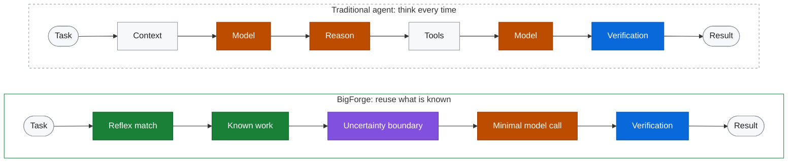
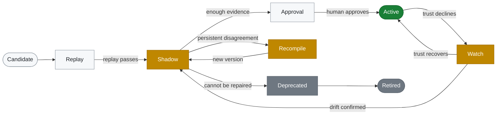
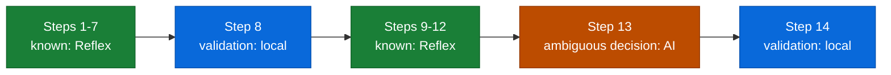
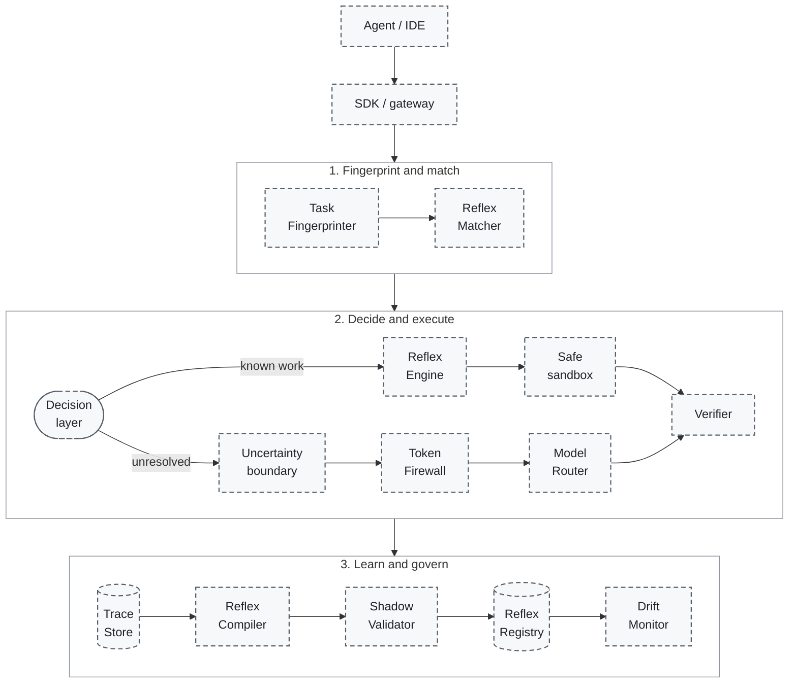

<div align="center">

# BigForge: the original design specification

**Forge reasoning once. Reuse it without paying to rethink it.**

</div>

> [!NOTE]
> **This is the original design document**, written before any code existed and kept for its reasoning, diagrams and evaluation plan. The implemented proof of concept, its real numbers and its limits are described in the [README](../README.md), [ARCHITECTURE.md](./ARCHITECTURE.md), [METRICS.md](./METRICS.md) and [KNOWN_LIMITATIONS.md](./KNOWN_LIMITATIONS.md); where this document differs, those win. Every performance figure below is either an **ILLUSTRATIVE EXAMPLE** or a *proposed* measurement, not a result. Several ideas here (Anti-Reflexes, Counterfactual Replay, Time Machine, the distributed Registry) are *not* implemented. Built for the *Hack for Tokenomics: The Zero-Waste AI Challenge* track.

[Thesis](#the-thesis) · [Comparison](#how-bigforge-compares) · [How it works](#how-bigforge-works) · [Demo](#the-5-minute-bigforge-demo) · [MVP](#mvp-scope) · [Evaluation](#evaluation-strategy)

## BigForge in 30 seconds

AI agents often re-solve problems they have already solved: read the logs, find the failing package, pick a diagnostic, verify the fix. Each run pays the full reasoning price again.

BigForge watches *successful* runs, finds the steps that never change, and compiles them into a **Reflex**: a versioned, testable, constrained, executable workflow derived from previously successful agent behavior. When a task from the same family returns, the known steps run through the Reflex. A model is consulted only for what is genuinely unresolved, and only with the evidence needed to answer it.



🟧 model tokens spent · 🟩 known work, no model · 🟪 uncertainty boundary · 🟦 verification

> **THINK EVERY TIME** → **REUSE WHAT IS KNOWN. THINK ONLY AT THE EDGE OF UNCERTAINTY.**

## The problem

Agent workflows often re-derive procedures that were already worked out: the same logs read, the same diagnostics run in the same order, routine decisions re-made, a large model asked to parse text a script could parse.

Most token-efficiency work optimizes *how* a model reasons: compress prompts, shorten tool output, retrieve memories, cache responses, route between models, reduce context, summarize history. These matter, and BigForge is meant to coexist with them. But they share one premise: **a model will be called.**

BigForge questions the premise:

> Why invoke AI at all for the parts of a workflow that have already been learned, validated, and can now be executed deterministically?

*Hypothesis, not a result:* in routine engineering workflows, a meaningful share of agent reasoning is repetition. Measuring that share is part of the proof of concept.

## The thesis

1. **Successful agent behavior contains invariants.** Across variants of a task, some steps never change; others depend on judgment.
2. **Invariants can be compiled** into constrained, typed, versioned, testable procedures: **Reflexes**.
3. **Models belong at the uncertainty boundary:** the smallest unresolved decision plus the minimum supporting evidence.
4. **Trust is earned and expires.** Reflexes are validated before use, monitored after, and demoted when the world changes.

BigForge is *designed to reduce repeated model reasoning*. Whether it does so without degrading correctness is exactly what the proof of concept must show.

## Why this is different

BigForge is **not primarily** prompt compression, semantic caching, AI memory, RAG, model routing, a cheaper-model selector, an LLM proxy, a prompt optimizer, or another coding agent. It is designed to sit beside all of them.

| Approach | What it changes |
|---|---|
| Prompt compression | The AI still reasons, but receives fewer tokens. |
| Memory | The AI retrieves previous knowledge, but generally still interprets and reasons over it. |
| Semantic caching | Reuses a previous answer when requests are sufficiently similar. |
| Model routing | Selects which model should reason. |
| **BigForge** | Attempts to convert validated, repeatable portions of AI reasoning into executable Reflexes, so those portions of future workflows may not need model reasoning at all. |

> Compression makes thinking cheaper.\
> Memory makes remembering cheaper.\
> Routing chooses who thinks.\
> **BigForge asks whether thinking needs to happen again.**

BigForge explores a different layer of AI efficiency: **compiling validated repeated execution rather than only optimizing the model call.**

## How BigForge compares

Different layers, mostly complementary. The tables cover concept categories plus three public projects, summarized from their own documentation on 2026-11-02. They are context, not a ranking: cells describe each approach's stated purpose, not a limitation, and no benchmark comparison is made or implied.

| Approach | AI still reasons? | Reuses knowledge? | Reuses deterministic execution? | Handles new inputs? | Can eliminate model calls? |
|---|---|---|---|---|---|
| Prompt / context compression | Yes | No | No | Yes | No |
| Semantic caching | On a miss | Yes, answers | No | If similar | On a hit |
| RAG / memory | Yes | Yes | No | Yes | No |
| Model routers | Yes | No | No | Yes | No |
| Agent token trimming | Yes | Partly | Partly | Yes | No |
| 🔨 **BigForge** | **Only at the boundary** | **Yes, as procedures** | **Yes** | **Within a task family** | **Designed to; unproven** |

| Approach | Primary optimization | Relationship to BigForge |
|---|---|---|
| Prompt / context compression | Fewer input tokens per call | Complementary: shrinks whatever must still be sent |
| Semantic caching | Reuse a prior answer for a similar request | Different: BigForge runs a verified procedure on the *current* inputs instead of returning a past output |
| RAG / memory, e.g. [MemPalace](https://github.com/MemPalace/mempalace) | Recall prior knowledge (MemPalace: verbatim storage with semantic search) | Complementary: memory recalls; BigForge asks whether reasoning is needed |
| Model routers, e.g. [GitHub Copilot Fusion](https://docs.github.com/en/copilot/concepts/models/copilot-fusion) | Choose models and an execution pattern per task | Complementary: can serve uncertainty-boundary calls |
| Agent token trimming, e.g. [Caveman](https://github.com/JuliusBrussee/caveman) | Shorter output, smaller tool and log input, model and effort choice, reusable scripts | Complementary; reusable scripts are the closest neighbor |
| 🔨 **BigForge** | **Compile validated repeated execution into Reflexes** | **Proposed: unproven until measured** |

Skill libraries, workflow memory, record-and-replay, and programming by demonstration are older relatives of this idea. BigForge's proposed contribution is the *governance loop* around reusable execution: multi-trace compilation, uncertainty boundaries, shadow validation, verification-first completion, and depreciation.

## How BigForge works

One loop: **observe → fingerprint → compile → validate → execute → escalate → evolve.**

1. **Observe.** Capture traces of successful agent runs: tool calls, evidence, verification results, token cost.
2. **Fingerprint.** Assign each task to a candidate *task family* by intent, toolchain, repository shape, failure type, error patterns, required permissions, files affected, and past Reflex success, not by exact prompt. "Why is CI red?", "Find my build failure.", "What is the first real error?" and "Which workspace broke?" could belong to one family. A false match is the most dangerous failure, so *false Reflex match rate* is a first-class metric.
3. **Compile.** Turn repeated traces into a *candidate* Reflex.
4. **Validate.** Replay, shadow-execute, then require human approval.
5. **Execute.** Run known steps through the Reflex in a sandbox. Completion requires verification.
6. **Escalate.** Cross the uncertainty boundary only for unresolved decisions, through the Token Firewall.
7. **Evolve.** Outcomes feed mutation, drift detection, and depreciation.

If nothing matches, the agent runs exactly as it would without BigForge, and that trace becomes learning material.

### The Reflex Compiler

```text
AI solves task ─▶ trace captured ─▶ repeated pattern discovered
  ─▶ task-specific detail removed ─▶ deterministic operations identified
  ─▶ judgment-dependent operations identified ─▶ safety boundaries generated
  ─▶ CANDIDATE REFLEX ─▶ replay validation ─▶ shadow execution
  ─▶ human approval ─▶ ACTIVE REFLEX
```

### Cold-start protection

The first successful trace never becomes an active Reflex. Promotion requires multiple examples, variation analysis, success/failure comparison, invariant-step discovery, safety analysis, replay testing, and shadow validation. The aim is to avoid overfitting automation to one lucky run.

### Verification-first completion

A workflow is not successful because the model said so, a command exited with code zero, or files changed. A Reflex declares explicit evidence: the relevant test passes, the original failure no longer reproduces, the build succeeds, the expected artifact exists, no unrelated files changed, security policy passes, or expected API behavior is observed.

> Execution without verification is automation.\
> Execution with evidence is a Reflex.

## Reflex lifecycle

Reflexes are earned, not assumed, and trust decays.



Green is trusted, amber is on probation, gray is end of life.

**Mutation.** When an unfamiliar variation is solved through AI escalation, the result becomes a new version, never an in-place edit:

```text
Reflex v3 ─▶ novel variation ─▶ AI escalation ─▶ successful resolution
  ─▶ candidate mutation ─▶ regression replay ─▶ shadow validation
  ─▶ approval ─▶ Reflex v4
```

Every Reflex keeps its version history and a rollback target.

## What a Reflex looks like

A Reflex conceptually contains: name, version, task family, typed inputs, preconditions, deterministic steps, tool permissions, expected outputs, verification rules, safety constraints, uncertainty boundaries, escalation conditions, compatibility information, confidence, validation history, and rollback information.

```yaml
# Illustrative sketch. Field names and values are placeholders, not a finalized schema.
reflex: first-causal-error
version: 3.1.0
task_family: monorepo-build-failure
status: active              # candidate | shadow | active | watch | deprecated | retired

inputs: { ci_log: { type: file, max_bytes: 5000000 }, repo_root: { type: path } }
preconditions: ["workspace_manager in [pnpm, npm]", 'failure_type == "build"']

steps:
  - { id: normalize, run: local.normalize_log }
  - { id: locate,    run: local.first_causal_error }
  - { id: map,       run: local.workspace_owner }
  - { id: diagnose,  run: local.focused_diagnostic }
  - { id: decide,    boundary: model, budget_tokens: 1500 }  # the only judgment step
  - { id: verify,    run: local.rerun_failing_target }
outputs: { root_failure: workspace_id, report: markdown }

permissions:
  read: ["repo/**"]
  write: ["repo/packages/**"]
  commands: ["pnpm build", "pnpm test"]
  limits: { network: false, secrets: none, timeout_s: 300 }
verify: [original_failure_gone, relevant_tests_pass, no_unrelated_changes]
escalate_when:                  # example thresholds, configurable
  - locate.confidence < 0.8
  - no_diagnostic_match
compatibility: { node: ">=20", pnpm: ">=9" }

# illustrative values
confidence: 0.91
validation: { replays: 24, shadow_runs: 12, agreement: 0.96 }
rollback_to: 3.0.2
```

**Composition.** Small Reflexes can compose into larger workflows, which is preferable to one opaque mega-workflow: *parse CI failure* + *locate causal error* + *map repository ownership* + *run focused diagnostic* + *verify repair*.

## Uncertainty boundaries

BigForge does not choose between *AI* and *no AI*. It **decomposes execution.**

**ILLUSTRATIVE EXAMPLE: a 14-step workflow**



**11** known steps → Reflex execution · **2** deterministic validations → local execution · **1** ambiguous architectural decision → AI reasoning.

Instead of sending the whole repository and history to a model, BigForge aims to send only the unresolved decision and the minimum evidence needed to settle it. The size of that boundary is itself a metric: a shrinking boundary suggests the system is learning.

> **Spend tokens on uncertainty, not repetition.**

## Killer features

Twenty ideas in four groups. **POC** is the *proposed* role in the first proof of concept: *Core* (in the 13-step MVP), *Basic* (simplified), *Stretch* (optional demo extension), *Later* (outside the MVP).

| Feature | Idea | POC |
|---|---|---|
| **Learn** | | |
| [Reflex Compiler](#the-reflex-compiler) | Successful traces become candidate Reflexes | Core |
| Semantic Task Fingerprinting | Match task *families*, not exact prompts ([how](#how-bigforge-works)) | Core |
| [Cold-Start Protection](#cold-start-protection) | The first lucky trace never becomes a Reflex | Core |
| [Reflex Mutation](#reflex-lifecycle) | AI-solved variations become new, validated versions | Later |
| Cross-Model Distillation | A strong model's solved task can seed a Reflex that a smaller model, or none, runs later. Learns only from visible traces, actions, evidence, and outcomes, never model internals | Later |
| **Execute** | | |
| [Uncertainty Boundary](#uncertainty-boundaries) | Only the unresolved decision reaches a model | Core |
| [Token Firewall](#token-firewall) | No unexplained model calls | Basic |
| [Reflex Composition](#what-a-reflex-looks-like) | Small Reflexes compose into larger workflows | Later |
| [Safe Reflex Sandbox](#safety-model) | Least-privilege execution; safety before savings | Basic |
| [Verification-First Completion](#verification-first-completion) | Evidence, not assertion, defines success | Core |
| **Trust** | | |
| [Shadow Brain](#shadow-brain) | Run AI and Reflex side by side before activation | Core |
| [Cognitive Depreciation](#cognitive-depreciation) | Trust decays; Reflexes age out | Stretch |
| [Drift Canary](#drift-canary) | Sampled AI-versus-Reflex agreement checks | Stretch |
| [Anti-Reflexes](#anti-reflexes) | Remember what wastes tokens or fails | Later |
| [Reflex Registry](#reflex-registry) | Governed library with owners, versions, and evidence | Basic (local files) |
| **Measure and see** | | |
| [Counterfactual Replay](#counterfactual-replay) | Retrospective estimate of avoidable model calls | Core |
| [Cognitive Reuse Ratio](#cognitive-reuse-ratio-crr) | Proposed signature metric | Core |
| [Cognitive ROI](#cognitive-roi) | Cost to learn versus model cost avoided | Basic |
| [Reflex Graph](#reflex-graph) | Visual execution graph that explains every node | Later |
| [BigForge Time Machine](#bigforge-time-machine) | Visualization of learning over time | Later |

## Token Firewall

> **No unexplained model calls.**

Before an agent may request a model call, BigForge conceptually asks:

1. What remains unknown?
2. Why can't an existing Reflex handle it?
3. What minimum context is required?
4. Which model capability is necessary?
5. What is the maximum permitted token budget?
6. What evidence must come back?
7. How will the result be verified?

The answers form a *call record* attached to the request, and policy returns one verdict:

| Verdict | Meaning |
|---|---|
| `ALLOW` | The call is justified, minimal, and within budget |
| `REDUCE CONTEXT` | The request carries more context than the open question needs |
| `USE SMALLER MODEL` | A cheaper model has the required capability |
| `USE EXISTING REFLEX` | A Reflex already covers the supposed unknown |
| `REQUEST HUMAN APPROVAL` | The call is costly, sensitive, or touches a protected environment |
| `DENY` | Unexplained, duplicated, over budget, or against policy |
| `ESCALATE` | A cheaper attempt failed verification: move up to a stronger model or a person |

## Shadow Brain

Before a Reflex replaces AI reasoning, **run both.**

```text
AI execution     --> result A --+
                                +--> compare --> evidence for or against activation
Reflex execution --> result B --+
```

Compared: outcome, verification result, commands and tools used, safety violations, runtime, token consumption, and failure modes.

**One successful example is not enough.** A Reflex becomes *eligible* for activation only after sufficient evidence, and a human still approves. Example gate (configurable, not validated): at least 10 shadow runs across at least 3 distinct variants, zero safety violations, and at least 95% agreement. Shadow mode costs tokens before it saves any; that cost is booked as learning investment ([Cognitive ROI](#cognitive-roi)).

## Cognitive depreciation

Reflexes are not trusted forever. Trust can decline when:

- dependencies, APIs, or tool behavior change
- repository structure changes
- security policies change
- the Reflex's success rate declines
- shadow disagreement increases

Possible actions: **Active → Watch → Shadow → Retrain / recompile → Deprecated → Retired** (see the [lifecycle](#reflex-lifecycle)). A security-policy change would suspend affected Reflexes until they are re-approved.

> Automation should age like software, not masquerade as permanent intelligence.

## Drift Canary

Periodically send a small sample of *familiar* tasks through both the Reflex and the AI, then measure outcome agreement.

**ILLUSTRATIVE EXAMPLE:** historic agreement 97%, current agreement 82%. BigForge detects the drop, lowers trust in the Reflex, and moves it back to Shadow.

Sample size, cadence, and thresholds are configurable; these figures are examples, not recommendations. The canary spends tokens by design, the price of vigilance, and is budgeted like any other model call.

## Anti-Reflexes

BigForge should learn not only what works, but which recurring approaches waste resources or fail:

- re-running identical diagnostics
- repeatedly reading enormous logs
- calling a large model for deterministic parsing
- failed command sequences
- unsafe repair strategies
- fixes known to introduce regressions

Each **Anti-Reflex** would record its evidence and a response (warn, redirect, or block), so agents are stopped before repeating a known bad path.

## Counterfactual Replay

Replay historical agent traces against the current Reflex library and ask:

> What fraction of these historical model calls could potentially have been avoided if today's Reflexes had already existed?

It would report candidate calls avoided, candidate tokens avoided, additional escalations, different verification results, safety-policy impact, and runtime differences.

> [!NOTE]
> These outputs are **RETROSPECTIVE ESTIMATES** unless measured from an actual rerun. They can overstate savings when the environment has changed since the trace was recorded, so they prioritize work; they do not prove savings.

## Metrics

Proposed measurements, grouped by the question they answer:

- **What does it cost?** Tokens per successful task · model calls per successful task · tokens avoided · learning investment · estimated lifetime saving
- **How much is reused?** Reflex hit rate · Reflex verification rate · escalation rate · uncertainty-boundary size
- **Can it be trusted?** Shadow agreement · Reflex drift · human approvals · rollback rate

Tokens avoided and lifetime saving are counterfactual, so they are labelled estimates unless measured.

### Cognitive Reuse Ratio (CRR)

```text
CRR =  validated reusable reasoning / execution
       ────────────────────────────────────────
       total reasoning / execution required
```

CRR is a **proposed project metric, not an established industry standard.** Work would be weighted by what the baseline agent spent on each step, so an expensive judgment call counts more than a trivial local step.

**ILLUSTRATIVE EXAMPLE:** CRR = 82% would mean approximately 82% of a workflow was completed through previously validated reusable execution rather than fresh model reasoning. CRR is only meaningful beside verification pass rate: reusing the wrong thing confidently yields a high CRR and a bad outcome.

### Cognitive ROI

Cost to learn and validate a Reflex, versus the cumulative future model cost it avoids:

```text
Cognitive ROI = (cost avoided − cost to learn) ÷ cost to learn
```

**ILLUSTRATIVE EXAMPLE** (assumes about 10,000 tokens avoided per execution across 31 executions):

| | Tokens |
|---|---|
| Learning investment | 48,000 |
| Subsequent estimated savings | 310,000 |
| **Net** | **+262,000** |
| Cognitive ROI | ≈ 5.5× |
| Break-even | execution #5 |

## Safety model

> [!WARNING]
> Saving tokens must never come at the cost of safety. When they conflict, safety wins.

Candidate and active Reflexes must run under constrained permissions:

- read-only by default
- allowlisted commands only
- file boundaries
- network controls
- execution timeouts and resource limits
- secrets unavailable
- destructive Git commands blocked
- protected environments require approval

Reflexes must not improvise. A failed precondition, an unexpected output, or a failed verification stops the Reflex and hands control to the ordinary agent or a person. Safety violations disqualify a Reflex in Shadow validation; they are not traded against savings.

## Target architecture

*The design as originally proposed; dashed outlines meant planned. The implemented architecture is in [ARCHITECTURE.md](./ARCHITECTURE.md).*



Top to bottom: band 1 maps a task to a family and a Reflex. Band 2 either runs known steps in a sandbox under least privilege or sends only the unresolved decision, through the Token Firewall, to a model, and verifies either way. Band 3 stores traces, compiles and shadow-validates candidates, governs the Registry, and monitors drift. Active Reflexes flow from the Registry back to the Matcher.

The SDK / gateway is an integration point, not the product: BigForge decides whether a call should exist, rather than proxying every call.

## The 5-Minute BigForge Demo

> [!NOTE]
> This was the *target script* for the proof of concept. The implemented guided demo follows it step by step (see [DEMO_GUIDE.md](./DEMO_GUIDE.md) for the script that was actually built and run). The numbers in this section remain **ILLUSTRATIVE EXAMPLES**; the real, labelled figures are in the product and in the validation ledger.

### Scene 1: Cold start

A coding agent receives a synthetic monorepo build failure. No Reflex exists. The AI reads logs, investigates, executes diagnostics, finds the problem, fixes it, and verifies. BigForge captures the trace.

Illustrative baseline: **8 model calls · 18,400 tokens · 0% Reflex coverage**

### Scene 2: Learning

Several variants of the same failure family run. BigForge finds what repeats: log normalization, first-causal-error detection, workspace mapping, diagnostic selection, and the verification sequence. A candidate Reflex appears.

### Scene 3: Shadow Brain

A new task arrives. The AI and the candidate Reflex both execute:

```text
AI      → root failure: packages/security    verify: PASS
Reflex  → root failure: packages/security    verify: PASS
Shadow agreement: MATCH      (repeated across enough runs for the demo)
```

### Scene 4: Promotion

The reviewer inspects the learned procedure, permissions, validation evidence, compatibility, stop conditions, and expected token saving, then presses **PROMOTE REFLEX**.

### Scene 5: The killer moment

A *new* build failure arrives. BigForge recognizes the task family. Instead of sending the whole workflow through a model:

- **10 known steps** execute locally through the Reflex.
- **1 unknown decision** escalates to AI. BigForge sends only the uncertainty boundary: the unresolved question, the viable options, and a minimal evidence excerpt.

**ILLUSTRATIVE EXAMPLE, not measured:**

| | Baseline agent | With BigForge |
|---|---|---|
| Model calls | 8 | 1 |
| Tokens | 18,400 | 1,050 |
| Potential reduction | n/a | **94.3%** |
| Verification outcome | PASS | PASS (same) |

### Scene 6: Drift

The repository's tool output changes, for example a test runner update rewrites its log format. The Reflex starts disagreeing with the reference execution, the Drift Canary reports falling agreement, trust decreases, and the Reflex returns to Shadow mode. BigForge does not blindly automate forever.

## MVP scope

The first BigForge proof of concept focuses on coding-agent workflows because they provide observable tool traces, deterministic verification through tests/builds, and measurable token consumption.

| # | Step | Question it answers |
|---|---|---|
| 1 | Capture several synthetic coding-agent traces | Does the trace format hold what matters? |
| 2 | Detect a repeated task family | Can variants be grouped without exact-prompt matching? |
| 3 | Extract invariant actions | Which steps never change across variants? |
| 4 | Generate a candidate Reflex | Can invariants become a constrained, typed procedure? |
| 5 | Replay it against historical samples | Would it have reproduced past outcomes? |
| 6 | Run it in Shadow Brain mode | Does it agree with the AI on unseen tasks? |
| 7 | Promote it manually | Is the evidence legible enough for a human decision? |
| 8 | Present a new task in the same family | Does fingerprinting match it, and only it? |
| 9 | Execute known steps through the Reflex | How much runs without a model? |
| 10 | Deliberately introduce one unknown condition | Does the Reflex know where its knowledge ends? |
| 11 | Trigger an uncertainty-boundary AI call | Can the escalation be small and sufficient? |
| 12 | Verify the final result | Is success shown by evidence? |
| 13 | Compare token and call usage against the baseline | What was saved, and what did learning cost? |

*Stretch:* Scene 6 of the demo (drift injection, canary disagreement, demotion to Shadow).

The POC succeeds on its synthetic corpus if the held-out run passes verification, repeated executions need fewer tokens and model calls per verified success than the baseline (learning cost reported separately), the injected unknown escalates instead of silently failing, and no safety-policy violation occurs. That shows feasibility, not general savings.

### What is intentionally NOT in the MVP

- Live IDE or coding-agent integration
- Model-provider adapters beyond a minimal stand-in
- Azure deployment
- A multi-user or distributed Reflex Registry, or any public marketplace
- Automatic promotion: promotion stays manual
- Embedding-based fingerprint learning: rule and feature based only
- Cross-model distillation, Reflex Graph UI, Time Machine
- More than one toolchain family
- Enterprise governance, RBAC, and compliance work
- Any claim of production readiness

## Future architecture

### Reflex Registry

A governed library, not a marketplace. Each entry would record: name, owner, version, compatibility, source task families, validation evidence, success rate, safety permissions, token savings, drift status, last validation, and deprecation state. The MVP would use local files and manual promotion.

### Reflex Graph

A visual execution graph, intended to become a signature product experience:

```text
Task ─▶ Fingerprint ─▶ Reflex match ─▶ Known execution ─▶ Uncertainty boundary
  ─▶ Model call ─▶ Verification ─▶ Outcome ─▶ Reflex evolution
```

Each node would explain why it ran, its cost and tokens, its evidence, its confidence, and its safety status.

### BigForge Time Machine

A visualization of an agent learning over time. **Illustrative trajectory, not measured:**

| Day | What it would show |
|---|---|
| 1 | Mostly AI reasoning |
| 7 | Task families detected |
| 14 | Reflex candidates validated |
| 30 | Routine workflows increasingly handled through Reflexes |
| 60 | Models increasingly focused on unfamiliar decisions |

## Proposed Azure integration

| Azure service | Proposed role |
|---|---|
| Azure Container Apps | BigForge gateway / API |
| Azure Functions or Container Apps jobs | Replay and evaluation workers |
| Azure Cosmos DB or PostgreSQL | Reflex metadata and governance |
| Azure Blob Storage | Traces and replay artifacts |
| Azure OpenAI | Uncertainty-boundary reasoning |
| Microsoft Foundry (formerly Azure AI Foundry) | Model and evaluation workflows, where appropriate |
| Azure Monitor / Application Insights | Telemetry: latency, model calls, token metrics |
| Azure Key Vault | Credentials and secrets |
| Microsoft Entra ID | Authentication and RBAC |
| Azure Service Bus | Asynchronous validation and replay jobs |

> [!NOTE]
> These are proposed deployment targets. No Azure deployment is claimed by the README-first proof of concept, which is intended to run locally.

## Responsible AI, privacy, and security

### Responsible AI

- **Human in the loop.** Promotion is manual in the MVP; demotion and rollback are designed to be always available and logged.
- **Legible automation.** Every Reflex step and model call should be able to say why it ran ([Reflex Graph](#reflex-graph)).
- **Meaningful verification.** Passing tests can hide a bad fix, and a Reflex can encode a flawed habit. Review and Anti-Reflexes exist for this reason.
- **Observable behavior only.** BigForge learns from externally visible traces, tool actions, evidence, and outcomes, not model internals. Review model-provider terms on output retention and reuse before storing traces.

### Privacy

- Traces can contain source code, logs, and secrets. The design defaults to local-first storage, redaction at capture, and retention limits; nothing leaves the machine or tenant without explicit opt-in.
- Sending only the uncertainty boundary to a model should reduce data exposure; that is to be verified, not assumed.
- The POC uses only synthetic repositories and traces, never real user data.

### Security

- **Untrusted input.** Logs, repositories, and tool output can carry prompt injection or poisoned traces. Embedded instructions must never become Reflex steps; compile only from verified-successful traces, with human review.
- **Enforced permissions.** A Reflex cannot widen its own permissions; the sandbox enforces them.
- **Integrity.** Reflexes are versioned artifacts with owners and audit trails; a production registry would add signing and RBAC.
- **Secrets and spend.** Secrets never enter traces or Reflexes (the POC uses none); token budgets and rate limits guard against runaway spend.
- **Auditability.** Every match, skip, escalation, and denial is logged with a reason.

## Evaluation strategy

A serious project must show that using fewer tokens does not damage quality.

> [!IMPORTANT]
> **The cheapest model call is the one that never needed to happen, but only when the outcome remains correct and verifiable.**

BigForge optimizes for **minimum AI consumption subject to quality, safety, and verification constraints**, not for minimum tokens alone.

### Experiment design (proposed)

Compare a **baseline agent** with **BigForge** on equivalent task families, with the same tasks, models, and verification harness.

- **Splits.** Learning variants versus held-out variants of the same family; out-of-family tasks to measure false matches; drift-injected variants.
- **Ablations.** BigForge without Shadow Brain, and without the Token Firewall, to test whether each earns its cost.
- **Repeats.** Several runs per condition, since model behavior is nondeterministic; report spread, not only means.
- **Honest accounting.** Learning, shadow, and canary tokens count against BigForge. Tokens come from provider-reported usage; cost uses a pinned price sheet.

| Dimension | Measured |
|---|---|
| Quality | Successful completion rate, verification pass rate, human intervention, rollbacks |
| Consumption | Model calls, input tokens, output tokens, total tokens, latency, cost per successful task |
| Reflex health | Reflex coverage, escalation frequency, shadow agreement, false Reflex match rate, drift detection |

### Hypotheses and failure conditions

- **H1.** Within a task family, BigForge uses fewer model calls and tokens per *verified* success than the baseline.
- **H2.** Verification pass rate and safety violations are no worse than baseline, within a margin set before running.
- **H3.** Shadow disagreement and the Drift Canary detect injected drift before a wrong result is accepted.
- **H4.** Learning investment pays back: Cognitive ROI turns positive within a plausible number of executions.

If a hypothesis fails for a task family, that is a finding and will be reported as one.

### Claims policy

Performance figures in this repository are labelled as an **ILLUSTRATIVE EXAMPLE**, a **RETROSPECTIVE ESTIMATE**, or a **measured result** with a linked method. There are currently no measured results.

## Roadmap

| Phase | Focus | Done when |
|---|---|---|
| 0. Specify | This README: vision, POC definition, evaluation plan | Reviewed |
| 1. Foundations | Trace format, synthetic corpus, task fingerprinting, Reflex schema | Variants of one failure family are captured and grouped |
| 2. Learn and validate | Local Reflex Compiler, replay harness, Shadow mode | A candidate Reflex replays correctly on held-out traces and shadow agreement is reported |
| 3. Measure | Token accounting, minimal dashboard, baseline-versus-BigForge comparison | Reproducible results with a published method |
| 4. Harden | Drift Canary, depreciation, Anti-Reflexes, mutation | Injected drift is detected and the Reflex is demoted |
| 5. Integrate (future) | Live coding-agent integration, provider adapters | Pilot on a real agent workflow |
| 6. Scale (future) | Azure deployment, distributed Registry, governance | Security and privacy review |

Dates are intentionally omitted until phase 1 establishes a realistic pace.

## Repository status (at the time of writing)

This section described the plan when the document was a specification only. The proof of concept has since been implemented; see the [README](../README.md) for what exists and [KNOWN_LIMITATIONS.md](./KNOWN_LIMITATIONS.md) for what does not. The items below are kept for the record.

**Planned first** (all implemented in the proof of concept: trace format, synthetic trace corpus, task fingerprinting, Reflex schema, local Reflex Compiler, replay harness, Shadow mode, token accounting, dashboard)

**Future** (not implemented)

- Live coding-agent integration
- Model provider adapters beyond the optional Azure OpenAI / OpenAI-compatible adapter
- Azure deployment (templates are written and validated locally; nothing is deployed)
- Distributed Reflex Registry
- Enterprise governance

## Contributing

Feedback on the concept, the Reflex schema and the evaluation design is welcome through GitHub Issues. A license has not been selected yet (see below), so please open an issue before investing in a larger pull request.

## License and status note

No license has been selected yet. The repository owner must choose one before external contributions are accepted or reuse is encouraged; until then all rights are reserved by default. Third-party projects named here belong to their authors and remain under their own licenses; references are for context and imply no affiliation or endorsement.

## Project philosophy

Reasoning is an expensive resource, best spent where it creates new information.

- Reuse what is known. Think only at the edge of uncertainty.
- Trust is earned with evidence and allowed to expire.
- Savings never outrank safety or correctness.
- Claims follow measurements, never the other way around.

**Forge reasoning once.**
